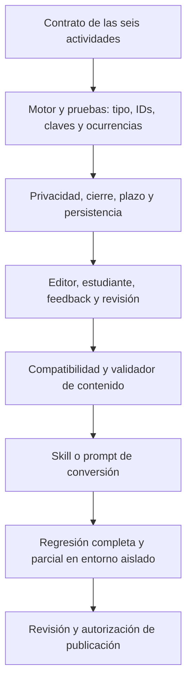

# Diagnóstico final de las seis actividades · EduEval v1.2

Fecha: 22 de octubre de 2026. Estado: **diagnóstico previo a mejoras, con pruebas estudiantiles reales completadas y limitaciones explícitas**. No constituye una aprobación para publicar ni una certificación de ausencia de fallas.

## 1. Conclusión y aclaración de versiones

La aplicación tiene un recorrido funcional aprovechable: crear sala, ingresar con código y nombre, esperar al docente, ejecutar los seis formatos, confirmar respuestas, terminar y consultar resultados persistentes. Las pruebas nuevas confirmaron ese recorrido y también fallas de plazo, cierre, recuperación y feedback. La prioridad es hacer coherente el contrato entre autoría, presentación, corrección y almacenamiento antes de mejorar la conversión JSON.

**La publicación v13 es la referencia pública intencional.** El usuario aclaró que la importación JSON pertenece a una prueba local y se incorporará a la versión pública cuando esté lista. Su ausencia en v13 no es un defecto, una regresión ni un despliegue pendiente que deba corregirse automáticamente. El trabajo de mejoras seguirá primero en esta carpeta y la publicación será una etapa posterior.

Este informe consolida:

- [Análisis de código, comparación externa y 22 hallazgos F01–F22](C:/Users/elmer/OneDrive/Desktop/EduEval-v12-Actividades/docs/ANALISIS_COMPARATIVO_ACTIVIDADES_V12.md).
- [Auditoría de lectura de la publicación y Supabase, R01–R15](C:/Users/elmer/OneDrive/Desktop/EduEval-v12-Actividades/docs/AUDITORIA_APP_PUBLICADA_SUPABASE_V12.md).
- [17 comprobaciones dirigidas y 96 escenarios de aceptación propuestos](C:/Users/elmer/OneDrive/Desktop/EduEval-v12-Actividades/docs/PLAN_VERIFICACION_ACTIVIDADES_V12.md).
- Las pruebas nuevas T01–T18 de este documento. Estos conjuntos no deben sumarse como si fueran una suite automatizada aprobada.

Las observaciones nuevas precisan los informes anteriores; no convierten en ejecutados todos los escenarios propuestos. La base es suficiente para iniciar mejoras locales con pruebas de regresión concretas.

## 2. Alcance autorizado y datos creados

El usuario autorizó crear una sala desde el panel docente e ingresar como estudiante con un nombre ficticio. Se usaron dos salas porque el límite vigente es de tres tipos por sala. Toda la creación y ejecución se realizó mediante la interfaz de la publicación; las consultas directas a Supabase fueron SELECT.

Se reutilizaron exclusivamente las seis actividades publicadas de **El Ciclo del Agua**. No se crearon ni modificaron plantillas, preguntas, opciones, respuestas correctas o explicaciones. Algunas opciones heredadas son precisamente objeto del diagnóstico; usarlas para reproducir un fallo no las valida pedagógicamente.

| Sala de prueba | Código | Participante ficticio | Configuración | Resultado guardado |
| --- | --- | --- | --- | --- |
| AUDITORÍA v1.2 · A · 22-10-2026 | `EDU-360` | Prueba V12 Lince 22 | Escenario, V/F y asociación, repetidos hasta seis preguntas; cinco minutos; diez puntos por pregunta; sin mezcla; regreso permitido. | `timeout`, 5 respondidas, 1 omitida, 3 correctas, **30/60**. |
| AUDITORÍA v1.2 · B · 22-10-2026 | `EDU-322` | Prueba V12 Colibri 22 | Clasificación, ordenamiento y selección única; tres preguntas; sin límite; diez puntos por pregunta; sin mezcla. | `completed`, 3 respondidas/correctas, **30/30**, entregado después del cierre docente. |

Ambas salas quedaron **finalizadas en Supabase**, con `archived_at = null`. A finalizó por acción docente a las 18:49:12.133 UTC; B a las 18:45:53.481 UTC. El archivado fue rechazado por el control automático de aprobación por considerarlo fuera de la autorización de crear/usarlas. No se intentó otra vía ni se borraron datos. El archivado queda pendiente de autorización específica.

| Entidad | Antes | Después | Cambio de esta prueba |
| --- | ---: | ---: | ---: |
| Salas | 4 | 6 | +2 |
| Relaciones sala–actividad | 12 | 21 | +9 ocurrencias |
| Participantes | 3 | 5 | +2 ficticios |
| Intentos | 3 | 5 | +2 |
| Respuestas | 9 | 18 | +9 |
| Plantillas / actividades / perfiles | 3 / 12 / 3 | 3 / 12 / 3 | Sin incremento |
| Eventos administrativos | 0 | 0 | No hay registro administrativo de estas acciones en `audit_events`. |

Los registros de prueba afectan los totales del panel; deben identificarse por estas salas, no interpretarse como alumnado real. No se modificó la sala preexistente `EDU-762`, ni los intentos históricos. No se cambió código publicado, funciones, políticas, claves o esquema de Supabase.

## 3. Evidencia nueva del recorrido real

| ID | Prueba ejecutada | Resultado observado | Lectura diagnóstica |
| --- | --- | --- | --- |
| T01 | Crear A y B desde docente con actividades cloud existentes. | Se guardaron dos salas y nueve relaciones; consulta SQL confirma configuración. | La creación y repetición funcionan en este caso. |
| T02 | Ingresar a A por código/nombre mientras está en espera e iniciar desde docente. | Se mostró espera y luego actividad 1 sin pulsar actualización. | El flujo de invitado y sondeo funciona en la sesión probada. |
| T03 | Elegir la decisión recomendada en A1. | Respuesta confirmada, controles bloqueados, feedback visible; servidor: 10 puntos. | Recorrido funcional sobre estructura heredada. |
| T04 | Elegir Verdadero en A2 y Falso en A5 para la misma afirmación de evaporación. | Servidor: 10 y 0 puntos; el feedback orientador fue el mismo. | Corrección de esas dos respuestas coherente con la clave; orientación no diferenciada. |
| T05 | Elegir un par en A3 y recargar antes de confirmar. | Se recuperó la actividad 3 y el tiempo no volvió a cinco minutos, pero el par elegido desapareció. | Pérdida real del borrador parcial, F19. |
| T06 | Completar tres pares y confirmar A3; regresar a A2. | Asociación: 10 puntos. La respuesta Verdadero anterior seguía elegida y bloqueada. | Persisten confirmaciones; regresar no habilitó reintento en este recorrido. |
| T07 | Ejecutar la repetición A4 de escenario con “Ignorar las consecuencias”. | Nueva ocurrencia inicialmente vacía; servidor: 0 puntos. Mostró el mismo mensaje favorable que A1. | Repetición diferenciada, pero feedback incoherente, F11. |
| T08 | Permanecer en feedback A5 y avanzar después de la fecha límite. | La UI todavía mostraba 00:25 y permitió entrar a A6; el cierre ocurrió tarde. | Plazo visual y fecha límite no coinciden, F05. |
| T09 | Seleccionar un par en A6 sin confirmar y dejar vencer el contador. | Finalizó sin mostrar nota. SQL: A6 omitida, `response = {}`, `time_seconds = 0`. | Pérdida de evidencia parcial y del tiempo de esa pregunta, F19/F20. No se adopta por ello puntaje parcial. |
| T10 | Arrastrar Evaporación a Ciencias Naturales en B1. | Se movió al destino y el selector reflejó la asignación. | Arrastre básico de clasificación comprobado. |
| T11 | Cambiar la categoría con selector y completar B1. | La reasignación funcionó; registro por tres IDs fallback; 10 puntos. | El selector accesible es útil. La corrección por posición sigue sin justificación pedagógica. |
| T12 | Ordenar B2 mediante flechas desde una lista mezclada. | Evaporación → Condensación → Precipitación → Colección; 10 puntos. | Flujo con flechas correcto; no se ofreció arrastre. |
| T13 | Elegir Condensación y luego Evaporación en B3. | Solo una opción quedó marcada. | Interacción de elección única, pese al nombre “Selección múltiple”. |
| T14 | Finalizar B desde docente antes de confirmar B3 y luego entregar desde estudiante. | Permitió confirmar y entregar; SQL guardó 30/30 después de `rooms.finished_at`. | Cierre no vinculante en UI/servidor, P0, F05. |
| T15 | Recargar estudiante después de entregar B. | Se conservó “Terminaste”, sin puntaje visible. | Recuperación de finalización visual comprobada; no certifica un acuse idempotente ante pérdida de red. |
| T16 | Abrir resultados docente después de entregar B y luego recargar. | Inicialmente seguían los tres intentos históricos; después de recargar apareció B. A también se verificó tras recarga. | Falta refresco fiable de resultados nuevos en la sesión abierta. |
| T17 | Salir de A e intentar ingresar nuevamente con el mismo nombre/código. | Mensaje “Ya tienes un intento registrado para esta sala”. | Bloqueo UI en el mismo navegador comprobado; no es prueba de segunda identidad/dispositivo. |
| T18 | Consultar ambas entregas, respuestas, eventos y estados en Supabase. | Dos intentos, nueve respuestas; A30/60 y B30/30; ambas salas finalmente `finished`. | Persistencia nueva confirmada por SELECT, además de la vista docente. |

### 3.1 Línea de tiempo del defecto de cierre

Las horas son UTC. Los eventos y fechas del intento proceden actualmente del cliente; se contrastaron con el estado SQL y las acciones observadas. No deben confundirse con un futuro sello autoritativo de recepción.

| Evento B | Hora |
| --- | --- |
| Sala iniciada | 18:44:52.978 |
| Docente finaliza la sala, confirmado por SELECT antes de enviar | 18:45:53.481 |
| Estudiante confirma la última respuesta | 18:46:13.670 |
| Finalización del intento guardado | 18:46:21.372 |

La confirmación ocurrió aproximadamente 20 segundos después del cierre y la entrega aproximadamente **28 segundos después**. No fue necesario modificar una petición ni usar una herramienta de ataque: bastaron los controles normales de la aplicación. Se debe resolver con una política de cierre/confirmación aplicada por servidor y una UI que refleje esa decisión.

### 3.2 Línea de tiempo del defecto de plazo

| Evento A | Hora |
| --- | --- |
| `rooms.started_at` | 18:42:29.683 |
| Fecha límite esperada: inicio + cinco minutos | 18:47:29.683 |
| Pantalla de feedback consultada después de la fecha límite | Continuaba mostrando 00:25 y permitía avanzar. |
| Intento `timeout` guardado | 18:48:20.429 |
| Estado de sala consultado a las 18:48:21.567 | Todavía `active`. |

La finalización del intento quedó aproximadamente **50,7 segundos después del plazo esperado**. La lectura del feedback no mantuvo un reloj fiable: hubo valores detenidos y reajustes visibles durante la sesión. No se afirma que permaneciera congelado de forma ininterrumpida desde la primera confirmación. El código local sí cancela su intervalo cuando `submitted` es verdadero; la observación real confirma el defecto de plazo, pero no identifica por sí sola la causa de cada reajuste.

La finalización del intento no finalizó la sala en servidor. Posteriormente se cerró A desde el docente. El sistema necesita un deadline autoritativo que no dependa de que una pestaña continúe ejecutando un intervalo.

### 3.3 Evidencia visual

- [Resultado A: aciertos, errores y omisión](C:/Users/elmer/OneDrive/Desktop/EduEval-v12-Actividades/docs/evidencias-v12/resultado-sala-A.png).
- [Resultado B persistido](C:/Users/elmer/OneDrive/Desktop/EduEval-v12-Actividades/docs/evidencias-v12/resultado-sala-B.png).
- [Feedback con reloj atrasado de A](C:/Users/elmer/OneDrive/Desktop/EduEval-v12-Actividades/docs/evidencias-v12/reloj-feedback-sala-A.png).
- [Final estudiantil sin nota](C:/Users/elmer/OneDrive/Desktop/EduEval-v12-Actividades/docs/evidencias-v12/cierre-estudiante-A.png).
- [Ambas salas finalizadas tras recarga](C:/Users/elmer/OneDrive/Desktop/EduEval-v12-Actividades/docs/evidencias-v12/salas-auditoria-finalizadas.png).

Una captura sola no prueba el tiempo transcurrido ni el estado de Supabase: las tablas anteriores y las consultas complementan las imágenes.

## 4. Diagnóstico completo por actividad

Los seis editores ya se inspeccionaron sin guardar en la auditoría anterior. Estas pruebas ejecutaron los seis registros publicados con `details = {}`; por tanto, confirman el camino heredado, no todos los casos posibles de autoría con `details` completos.

### Escenario de decisiones

**Actual:** el editor admite etapas/opciones/consecuencias; el generador y los datos publicados conservan alternativas genéricas y dependen de normalización heredada. El estudiante vio el contexto repetido como consigna de una única etapa. Confirmó opciones, recibió feedback y sus elecciones quedaron tipadas en `choices.fallback-stage`.

**Fallas:** el generador fabrica alternativas; la validación local permite una etapa sin recomendación si otra sí la tiene; la vista no implementa consistentemente el recorrido específico por etapas/consecuencias. En la prueba, elegir “Ignorar las consecuencias” mostró “Se reduce el impacto de la sequía asegurando reservas mínimas de agua”, igual que la opción recomendada, aunque el servidor dio 0 puntos.

**Corrección:** contrato por etapa con IDs, opciones y consecuencia respaldada; exactamente una recomendación por etapa del formato actual; claves privadas; feedback asociado a la opción confirmada. Rechazar o dejar pendiente de autoría el escenario incompleto. No transformar este formato lineal en un árbol ramificado para imitar otra plataforma. Prioridad P0 para contrato/generación y P1 para recorrido/feedback seguro.

### Falso/verdadero

**Actual:** afirmación visible, elección exclusiva, confirmación y bloqueo posterior. La afirmación existente sobre evaporación obtuvo 10 puntos con Verdadero y 0 con Falso; ambas respuestas se almacenaron correctamente en el servidor.

**Fallas:** generación con clave verdadera por defecto; explicación/feedback no separados suficientemente de la clave; riesgo de divergencia entre evaluación local sanitizada y privada ya reproducido. La prueba nueva no reprodujo una calificación final errónea en Supabase para este caso: debe preservarse esa precisión.

**Corrección:** valor esperado explícito y respaldado, validador booleano, explicación privada y orientación pública distinta. Un texto expositivo no debe convertirse automáticamente en una afirmación falsa inventada. Mantener ambos valores, omisión y rechazo de valores ajenos en las pruebas. P0 para motor/privacidad; P1 para autoría/feedback.

### Asociación

**Actual:** tres selectores concepto→definición; completar los tres pares permitió confirmar y el servidor guardó 10 puntos. Se reutilizó la actividad como una ocurrencia distinta.

**Fallas:** definición en el mismo orden de los conceptos, reutilización de destinos y claves basadas en texto; colisiones con etiquetas duplicadas reproducidas localmente. Al recargar un par sin confirmar desapareció; al agotar tiempo en otra ocurrencia, un par ya elegido quedó completamente ausente y se registraron cero segundos.

**Corrección:** dos conjuntos públicos sin la relación correcta, IDs estables, correspondencia uno a uno validada y mezcla persistida de destinos; conservar borradores y tiempo por ocurrencia. Distinguir “borrador existente no confirmado” de “sin interacción”, sin conceder puntos automáticamente. P0 para identidad/validación; P1 para interacción y recuperación.

### Clasificación

**Actual:** arrastre básico comprobado, selector alternativo y reasignación funcional. La entrega guardó tres asignaciones y 10 puntos.

**Fallas:** se evalúa el mapeo heredado Evaporación→Ciencias Naturales, Condensación→Ecología, Precipitación→Ciclos Biogeoquímicos sin evidencia explícita en la plantilla que lo sostenga. Obtener 10 puntos prueba coincidencia con esa clave, no validez de la clasificación. Las fichas ya colocadas dejan de ser arrastrables; el selector sí permite cambiarlas. El detalle docente muestra IDs fallback en lugar de etiquetas legibles.

**Corrección:** relación explícita elemento→categoría como requisito; nunca asignar por posición. Separar pertenencia privada de destinos públicos; permitir reasignar con arrastre y teclado/selector; resolver IDs a etiquetas para informes. P0 para evidencia/generación; P1 para interacción y reporte.

### Ordenamiento

**Actual:** la lista se presentó mezclada, las flechas funcionaron y la secuencia correcta quedó guardada con 10 puntos. Los extremos deshabilitan movimientos fuera de rango y la confirmación bloquea los controles.

**Fallas:** no hay arrastre en la vista observada, aunque forma parte del requisito; los pasos se identifican por texto y la validación local admite listas ajenas con cardinalidad compatible. El orden de presentación no tiene el modelo persistente por ocurrencia requerido para reconexión robusta.

**Corrección:** IDs de pasos, orden correcto privado y lista mezclada persistente; validar exactamente el conjunto esperado, sin duplicados/omisiones/extras. Añadir arrastre y mantener flechas accesibles. El orden cíclico del contenido necesita un inicio indicado por el docente cuando pueda haber varias rotaciones válidas; no inferirlo. P0 para pertenencia/contrato; P1 para arrastre/restauración.

### Selección única

**Actual:** se elige una sola opción y cambiar de elección desmarca la anterior. Evaporación obtuvo 10 puntos, siguiendo la primera clave heredada.

**Fallas:** la consigna genérica “Selecciona la opción que mejor representa el contenido aprendido” no fundamenta una única alternativa; la generación incorpora “Ninguna de las anteriores” sin respaldo y marca el primer concepto. Etiquetas como identidad y nombre “Selección múltiple” crean problemas distintos: el primero afecta integridad, el segundo comprensión de la interfaz.

**Corrección:** pregunta concreta, alternativas y exactamente una respuesta respaldadas por la fuente o autoría explícita; respuesta por ID, cardinalidad uno y semántica de radio accesible. Llamar “Selección única”. P0 para contenido/clave/validación; P2 para terminología, a realizar junto al editor cuando corresponda.

## 5. Archivos y responsabilidades de las mejoras

Las referencias son de la copia local auditada; los números cambiarán durante la implementación.

| Archivo/punto | Qué debe resolverse |
| --- | --- |
| [activityEngine.ts](C:/Users/elmer/OneDrive/Desktop/EduEval-v12-Actividades/src/lib/activityEngine.ts:1) | Unión discriminada por tipo, validación de respuestas, IDs, corrección y política exacta compartida. El normalizador heredado no debe completar evidencia inexistente. |
| [App.tsx: modelos](C:/Users/elmer/OneDrive/Desktop/EduEval-v12-Actividades/src/App.tsx:20) | Separar definición, presentación pública, clave privada, ocurrencia, borrador, confirmación e intento. |
| [App.tsx: generador](C:/Users/elmer/OneDrive/Desktop/EduEval-v12-Actividades/src/App.tsx:1547) | Eliminar alternativas/mapeos/claves por defecto; producir `details` específicos solo cuando existe evidencia. |
| [App.tsx: editores](C:/Users/elmer/OneDrive/Desktop/EduEval-v12-Actividades/src/App.tsx:1661) | Validadores por tipo, evidencia visible y autoría explícita. |
| [App.tsx: revisión](C:/Users/elmer/OneDrive/Desktop/EduEval-v12-Actividades/src/App.tsx:1819) | Revisar y editar la actividad completa antes de aprobar; no solo aceptar una tarjeta. |
| [App.tsx: estudiante](C:/Users/elmer/OneDrive/Desktop/EduEval-v12-Actividades/src/App.tsx:1901) | Reloj absoluto, bloqueo al cierre, borrador persistente, feedback de elección, arrastre y accesibilidad. |
| [App.tsx: persistencia y finalización](C:/Users/elmer/OneDrive/Desktop/EduEval-v12-Actividades/src/App.tsx:1023) | Acuse real, estados de envío, recuperación idempotente y resultados autoritativos. |
| [App.tsx: lectura cloud](C:/Users/elmer/OneDrive/Desktop/EduEval-v12-Actividades/src/App.tsx:465) | Refresco de resultados nuevos y reconciliación de estado entre pestañas/servidor. |
| [App.tsx: CSV](C:/Users/elmer/OneDrive/Desktop/EduEval-v12-Actividades/src/App.tsx:1211) | Exportar evidencia legible, feedback/eventos y texto seguro para hojas de cálculo. |
| [sync.ts](C:/Users/elmer/OneDrive/Desktop/EduEval-v12-Actividades/src/lib/sync.ts:1) | Cola de estudiante con credencial propia, independiente del perfil docente. |
| [student-room-guest](C:/Users/elmer/OneDrive/Desktop/EduEval-v12-Actividades/supabase/functions/student-room-guest/index.ts:129) y [student-room-sync](C:/Users/elmer/OneDrive/Desktop/EduEval-v12-Actividades/supabase/functions/student-room-sync/index.ts:1) | Proyección pública explícita, validación completa por ocurrencia, deadline/estado y corrección compartida. Preparar localmente; desplegar solo en una fase posterior autorizada. |
| [contentImport.ts](C:/Users/elmer/OneDrive/Desktop/EduEval-v12-Actividades/src/lib/contentImport.ts:1) y [esquema](C:/Users/elmer/OneDrive/Desktop/EduEval-v12-Actividades/src/lib/edueval-content-v1.schema.json:1) | Después del motor: expresividad del contrato de contenido, campos opcionales, compatibilidad por evidencia, errores por ruta. |
| [Pruebas del motor](C:/Users/elmer/OneDrive/Desktop/EduEval-v12-Actividades/src/lib/activityEngine.test.ts:1) y [pruebas de importación](C:/Users/elmer/OneDrive/Desktop/EduEval-v12-Actividades/src/lib/contentImport.test.ts:1) | Convertir cada reproducción en expectativa correcta de regresión; no fijar comportamientos defectuosos como deseados. |

Se mantienen las restricciones SQL útiles ya verificadas: un intento por participante y un índice único por intento. Las mejoras necesitan complementar esas garantías, no eliminarlas. Las siete migraciones remotas deben reconciliarse con la copia local antes de construir un entorno de backend reproducible.

## 6. Prioridad final y secuencia de implementación

P0 significa integridad/privacidad/validez que bloquea considerar confiable una evaluación. P1 significa recuperación, revisión y operación completa. P2 corresponde a presentación/claridad. La prioridad no sustituye las dependencias: primero se fija el contrato que utilizarán las correcciones.

| Orden | Trabajo concreto | Prioridad/hallazgos | Criterio de aceptación |
| --- | --- | --- | --- |
| 1 | Contratos específicos de las seis, proyección pública y claves privadas; estado heredado explícito. | P0: F06, F08, F12, F13, F17. | Cada actividad válida tiene estructura y clave sustentada; no se inventa información para migrar los doce registros existentes. |
| 2 | Motor único con validación estricta de tipo/IDs, pertenencia y conjunto de ocurrencias. | P0: F02–F04, F13, F21. | Respuestas de otro tipo, IDs ajenos y duplicados no se puntúan; omisiones no reducen el denominador de la sala. |
| 3 | Eliminar secretos de salida, exigir estado/plazo en servidor, separar resultados privados del acuse. | P0: F01, F05, F11. | Ninguna clave privada en todo el JSON estudiantil; confirmar/enviar tras cierre no puede alterar el resultado; deadline común incluso en feedback/recarga. |
| 4 | Generadores y editores por evidencia, feedback vinculado, revisión editable y controles completos. | P0/P1: F06, F11, F12, F14, F15, F18. | Recorrido completo por tipo y rechazo del contenido insuficiente; orientación coherente sin revelar solución. |
| 5 | Borradores y mezcla persistentes, acuse idempotente, cola guest, refresco docente y exportación. | P1: F16, F19, F20; observaciones nuevas de T16/T09. | Recuperación sin perder elecciones; un solo intento ante reenvío; interfaz distingue pendiente/recibido y conserva evidencia legible. |
| 6 | Evolución del contenido/compatibilidad/validador, incluyendo opcionales. | P0/P1: F07–F10. | Válido, incompleto, compatible y pendiente de revisión no se confunden; categorías solas no habilitan clasificación. |
| 7 | Skill/prompt externo y pruebas completas/parciales. | F21 y decisiones pedagógicas. | No inventa contenido; evidencia rastreable y mismas expectativas entre esquema, runtime, generador y revisión. |
| 8 | Regresión técnica, responsive, asistencia, backend y publicación posterior. | P0 para salida; P2 terminología F22. | Tests/build y criterios de aceptación ejecutados; publicación únicamente después de revisión y autorización. |

El primer entregable de mejoras debe ser el contrato interno de las seis y sus pruebas negativas/positivas, junto al diseño público/privado. No conviene comenzar por cambiar el texto del prompt ni por publicar el importador experimental.

## 7. Decisiones de diseño propuestas para comenzar

Estas propuestas concretan la base de trabajo; todavía no son código implementado:

- Mantener el puntaje exacto actual por ocurrencia como primera corrección. El puntaje parcial requiere una política explícita por tipo; no debe introducirse por imitar una plataforma.
- Mantener una confirmación por ocurrencia, revisión retrospectiva bloqueada y un intento por sala. Repetir una actividad crea otra ocurrencia identificable, no reutiliza el borrador de la anterior.
- Guardar el borrador como evidencia separada. Al vencer, una respuesta no confirmada puede seguir sin puntuar, pero no debe desaparecer silenciosamente ni simular cero tiempo de interacción.
- El servidor decide cuándo una confirmación es aceptada. El cierre y el plazo congelan lo ya admitido. La política de recuperación de envíos pendientes debe definirse sin confiar en fechas declaradas por el navegador.
- Conservar versión y snapshot de definición, presentación, criterio y feedback aplicado; los resultados históricos no se recalifican al editar una actividad.
- Si falta evidencia, mantener contenido guardable y actividad no disponible/pendiente de completar, con motivo. La ausencia de objetivo/competencia se informa sin inventarlos ni invalidar automáticamente todo el contenido.
- Revisar los doce registros heredados antes de migrarlos a un contrato estricto. Preservar intentos históricos y marcar procedencia; no reasignar claves automáticamente.

## 8. Base para aproximadamente 21 actividades

La ampliación debe hacerse mediante módulos completos por tipo y un núcleo común de sesión. Cada módulo aporta contrato/validación, editor, proyección pública, interacción estudiantil, respuesta, evaluación, feedback permitido, serialización e invariantes de prueba. El núcleo gestiona identidad, sala, ocurrencias, tiempos, confirmaciones, persistencia y exportación.

Un registro estático reúne únicamente los seis módulos conocidos. No se definen ahora los otros quince ni se amplía preventivamente el contrato con campos vacíos. Cuando se apruebe un tipo nuevo, también habrá que evolucionar la restricción real `activities_type_check`, que hoy permite seis valores, y su versión de datos.

Las referencias documentadas de H5P, Moodle, Canvas, QTI y W3C se usan para fundamentar patrones de autoría/interacción y separación de responsabilidades. No se copian ranking, exposición de nota, penalizaciones o generación de contenido que contradigan las decisiones de EduEval. Las fuentes y sus límites están enlazados en el análisis comparativo.

## 9. Límites que permanecen como puertas de aceptación

Se terminó el diagnóstico con recorrido real de los seis formatos publicados. No se afirma que se hayan ejecutado exhaustivamente todos sus casos límite.

- No se probó una pérdida real de red ni de acuse: recargar con conexión no equivale a desconectar. El navegador disponible no ofreció una capacidad documentada de desconexión; no se alteró la red del equipo. Cola guest e idempotencia siguen sustentadas por inspección y restricciones SQL, pendientes de prueba controlada.
- No se enviaron paquetes manipulados, no se probaron carreras de concurrencia/cupo ni acceso entre dos docentes. F01/F02/F03 conservan su evidencia local y de código desplegado; no se afirma captura de respuestas HTTP privadas durante esta sesión.
- La prueba usó paneles separados en el mismo navegador, que comparte sesión del propietario. El flujo estudiantil utilizado es guest, pero esto no sustituye una comprobación en un dispositivo limpio sin sesión docente.
- No se crearon actividades nuevas con `details` completos. Los seis editores se inspeccionaron y el código se auditó; el nuevo recorrido real cubre las actividades heredadas existentes. Los casos multietapa, etiquetas duplicadas y claves falsas de autoría específica requieren fixtures y regresión aislada.
- Se observó una pantalla a ancho efectivo 628 sin desbordamiento, pero la solicitud de viewport 360 no se aplicó a la pestaña esperada. Se restableció el viewport. No se declara aprobada la ejecución de las seis a 360 px ni en Android físico. La inspección anterior de entrada a 360 sigue siendo solo eso.
- El CSV de nueve respuestas históricas se descargó y verificó en la auditoría previa. No se descargó de nuevo para estos dos intentos ni se abrió Excel/LibreOffice. La ausencia de feedback/eventos y los IDs ilegibles permanecen pendientes de corrección.
- `npm` no está disponible en PATH y falta `node_modules` en esta copia. Los intentos anteriores de test/build no iniciaron; no se repitieron comandos que siguen sin entorno ni se instalaron dependencias para esta fase documental. No se declaran aprobados Vitest, TypeScript o build actuales.
- Se observó una discrepancia transitoria: después de cerrar A, la pestaña docente volvió a mostrar “En curso”, mientras SELECT devolvió `finished`; recargar restableció “Finalizada”. Se documenta como defecto de reconciliación visible, sin atribuir una causa no demostrada. La publicación no se cambió para investigarlo.

Estas limitaciones se convierten en pruebas de aceptación de las mejoras. No impiden empezar por los defectos reproducidos, pero sí impiden afirmar que la aplicación está lista para una nueva publicación.
