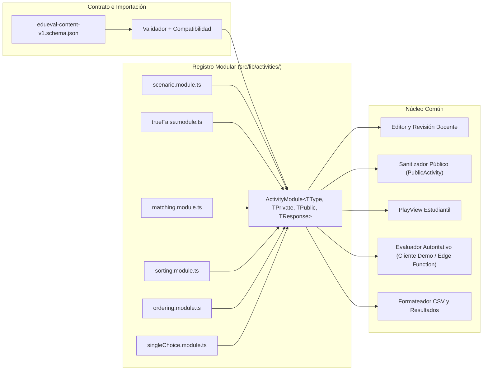

# Diagnóstico Técnico Integral de las Seis Actividades · Revisión Antigravity (EduEval v1.2)

- **Fecha de revisión:** 24 de octubre de 2026
- **Carpeta auditada:** `C:\Users\elmer\OneDrive\Desktop\EduEval-v12-Actividades - copia`
- **Alcance:** Auditoría estática y estructural de extremo a extremo de las seis actividades actuales (`scenario`, `trueFalse`, `matching`, `sorting`, `ordering`, `singleChoice`) y del núcleo común de sesión, sincronización, validación, privacidad y persistencia.
- **Estado de cambios:** **Cero modificaciones** en código fuente, contrato JSON, validador, prompt/skill, base de datos Supabase, migraciones, Edge Functions o publicación.

---

## 1. Resumen ejecutivo, separación de versiones y clasificación de evidencias

### 1.1 Estado general y separación de versiones

El proyecto EduEval (visible en interfaz como **EvaluEdu**) cuenta con una base funcional completa en su recorrido visual y operativo para los tres roles (`admin`, `teacher`, `student`), seis editores específicos, un motor puro extraído en [`src/lib/activityEngine.ts`](../src/lib/activityEngine.ts), un validador de importación JSON en [`src/lib/contentImport.ts`](../src/lib/contentImport.ts), persistencia conectada a Supabase con cola local en [`src/lib/sync.ts`](../src/lib/sync.ts) y dos Edge Functions estudiantiles ([`student-room-guest`](../supabase/functions/student-room-guest/index.ts) y [`student-room-sync`](../supabase/functions/student-room-sync/index.ts)).

**Aclaración sobre la versión publicada:** La versión pública **v13** en `https://evaluedu.elmer-yale99-torrez.chatgpt.site/` es la publicación intencional vigente. El flujo de importación JSON (`edueval.content` v1) pertenece al desarrollo local en esta carpeta de trabajo; su ausencia en la publicación v13 **no constituye una falla ni una tarea de despliegue inmediato**.

Sin embargo, la inspección exhaustiva del código fuente confirma que **los 21 problemas listados para verificación continúan vigentes en el código actual**, y además permitió identificar **cuatro hallazgos técnicos adicionales (`F23`–`F26`)** y precisar la causa exacta en código de comportamientos observados en pruebas previas (como la pausa del cronómetro durante la lectura de retroalimentación, la contaminación de `localStorage` cuando docente y estudiante comparten navegador, y el bloqueo permanente del elemento `1 pendiente` en la cola de sincronización).

### 1.2 Clasificación de niveles de evidencia utilizados en este informe

En estricto cumplimiento de las reglas de auditoría, cada afirmación de este documento distingue entre seis categorías de evidencia:

| Nivel | Etiqueta en este informe | Significado exacto |
| :---: | --- | --- |
| **1** | **Confirmado por inspección del código** | Verificado directamente línea por línea en los archivos locales de esta carpeta durante la presente revisión. |
| **2** | **Reproducido mediante una prueba local** | Comprobado por ejecución local sin red: validación sintáctica y de integridad SHA-256 en PowerShell en esta sesión, junto con las 17 comprobaciones dirigidas en memoria (`E01`–`E17`) registradas en [`docs/PLAN_VERIFICACION_ACTIVIDADES_V12.md`](./PLAN_VERIFICACION_ACTIVIDADES_V12.md). |
| **3** | **Observado en la aplicación publicada** | Comprobado en la interfaz publicada v13 según la evidencia documentada en [`docs/AUDITORIA_APP_PUBLICADA_SUPABASE_V12.md`](./AUDITORIA_APP_PUBLICADA_SUPABASE_V12.md) (`R01`–`R15`) y [`docs/DIAGNOSTICO_FINAL_ACTIVIDADES_V12.md`](./DIAGNOSTICO_FINAL_ACTIVIDADES_V12.md) (`T01`–`T18`). |
| **4** | **Confirmado mediante lectura de Supabase** | Comprobado mediante las consultas de solo lectura (`SELECT`, catálogo `pg_constraint`, políticas RLS y código desplegado de Edge Functions) documentadas en [`docs/AUDITORIA_APP_PUBLICADA_SUPABASE_V12.md`](./AUDITORIA_APP_PUBLICADA_SUPABASE_V12.md) y [`docs/DIAGNOSTICO_FINAL_ACTIVIDADES_V12.md`](./DIAGNOSTICO_FINAL_ACTIVIDADES_V12.md). *(En la presente sesión de Antigravity no existen credenciales en `.env.local` ni conector MCP activo, por lo que no se emitieron peticiones remotas nuevas).* |
| **5** | **Riesgo pendiente de verificación** | Comportamiento inferido con base técnica sólida pero cuya manifestación en dispositivos físicos, concurrencia de red o programas externos (Excel/LibreOffice) requiere una prueba controlada aún no ejecutada. |
| **6** | **Propuesta de corrección** | Diseño técnico recomendado para las fases de implementación posteriores; no describe código ya implementado. |

---

## 2. Auditoría de extremo a extremo de las seis actividades actuales

A continuación se auditan los 22 puntos requeridos para cada uno de los seis formatos actuales. Los aspectos transversales (tiempo límite, cierre de sala, reconexión, sincronización y exportación) afectan a las seis actividades por compartir `PlayView`, `finishStudentAttempt`, `persistCloudAttempt` y `student-room-guest`, y se detallan tanto en su impacto específico por actividad como en la sección 3 (Núcleo común).

---

### 2.1 Actividad 1: Escenario de decisiones (`scenario`)

| Aspecto auditado | Estado y análisis técnico (Archivos y líneas) | Nivel de evidencia |
| --- | --- | --- |
| **1. Contrato y estructura interna** | En [`src/lib/activityEngine.ts:3-4, 9`](../src/lib/activityEngine.ts#L3-L9), `details.scenario` es opcional y contiene `{ situation: string; stages: ScenarioStage[] }`, donde cada etapa tiene `{ id, title, prompt, options: ScenarioOption[] }` y cada opción `{ id, text, consequence, feedback, recommended: boolean }`. Si `details.scenario` no existe, `activityRuntime` (`líneas 58, 65`) construye un fallback de una sola etapa (`id: 'fallback-stage'`) usando `activity.options` y `text === activity.answer`. | 1. Confirmado por inspección del código |
| **2. Datos de entrada** | En [`src/lib/contentImport.ts:14-19`](../src/lib/contentImport.ts#L14-L19) y [`edueval-content-v1.schema.json:36-50`](../src/lib/edueval-content-v1.schema.json#L36-L50), cada elemento de `content.situations` solo admite `{ title, context, decision, consequence }`. No existe estructura para representar múltiples alternativas reales ni sus consecuencias diferenciadas. | 1. Confirmado por inspección del código |
| **3. Generación** | En [`src/App.tsx:1558`](../src/App.tsx#L1558), `buildActivitiesFromTemplate` crea la actividad **sin `details`** y fabrica dos opciones genéricas codificadas en duro: `['Analizar otra alternativa antes de decidir', 'Ignorar las consecuencias']` junto a `firstSituation.decision`. | 1. Confirmado por inspección del código / 2. Reproducido (`E15`) |
| **4. Editor docente** | En [`src/App.tsx:1670-1678`](../src/App.tsx#L1670-L1678) y [`1742-1750`](../src/App.tsx#L1742-L1750), `createEditorState` prellena las mismas dos alternativas genéricas. `validateActivityEditor` (`líneas 1702-1707`) valida recomendación con `value.scenario.stages.some((stage) => stage.options.some((option) => option.recommended))`, permitiendo guardar escenarios multietapa donde la etapa 2 no tiene ninguna opción recomendada. | 1. Confirmado por inspección del código / 2. Reproducido (`E17`) |
| **5. Revisión y aprobación** | En [`src/App.tsx:1819`](../src/App.tsx#L1819), `ProposalsView` solo muestra `activity.title` y `activity.prompt` con botones `Devolver` y `✓ Aprobar`. No muestra las etapas, las opciones, las consecuencias ni cuál es la opción recomendada, ni permite abrir el editor antes de aprobar. Además, crear una plantilla manual y pulsar `Aceptar contenido` (`línea 848`) publica directamente las actividades generadas (`status: 'published'`). | 1. Confirmado por inspección del código |
| **6. Vista del estudiante** | En [`src/App.tsx:1913, 1915`](../src/App.tsx#L1913-L1915), `PlayView` muestra `item.prompt` pero **nunca renderiza `runtime.scenario.situation`**. `ScenarioQuestion` renderiza todas las etapas simultáneamente en una sola vista, no de forma secuencial, y nunca muestra la `consequence` de la opción elegida. | 1. Confirmado por inspección del código / 3. Observado en app publicada (`T03`, `T07`) |
| **7. Interacción** | En [`src/App.tsx:1915`](../src/App.tsx#L1915), cada opción es un `<button>` que asigna `response.choices[stage.id] = option.text`. Antes de pulsar `Comprobar respuesta`, el estudiante puede cambiar libremente la selección en cualquier etapa; después de confirmar (`submitted === true`), los botones quedan `disabled`. | 1. Confirmado por inspección del código |
| **8. Estructura de respuesta** | En [`src/lib/activityEngine.ts:33`](../src/lib/activityEngine.ts#L33), `{ type: 'scenario'; choices: Record<string, string> }`, donde la clave es `stage.id` pero el valor almacenado es el **texto** (`option.text`) en lugar de `option.id`. | 1. Confirmado por inspección del código |
| **9. Validación de completitud** | En [`src/lib/activityEngine.ts:84`](../src/lib/activityEngine.ts#L84), `isResponseComplete` verifica `runtime.scenario.stages.every((stage) => Boolean(response.choices[stage.id]))`. No valida que `activity.type === 'scenario'`, ni que el valor elegido pertenezca a `stage.options`, ni rechaza claves extra en `choices`. | 1. Confirmado por inspección del código |
| **10. Comparación de respuestas** | En [`src/lib/activityEngine.ts:94`](../src/lib/activityEngine.ts#L94), `compareActivityResponse` exige que en **todas** las etapas la opción cuyo `option.text === response.choices[stage.id]` tenga `recommended === true`. Si dos opciones tienen el mismo texto, `.find()` toma siempre la primera. Si una etapa no tuvo opción recomendada (permitido por el editor), la actividad es imposible de acertar. | 1. Confirmado por inspección del código |
| **11. Feedback** | En [`src/App.tsx:1913`](../src/App.tsx#L1913), al confirmar se muestra `<p>{item.feedback}</p>`, que es único para toda la actividad (y en `editorStateToActivity`, `línea 1721`, se copió de la opción recomendada). Ignora `option.feedback` y `option.consequence` de la opción realmente seleccionada. Por eso elegir *"Ignorar las consecuencias"* muestra el mensaje favorable de la opción recomendada. | 1. Confirmado por inspección del código / 3. Observado en app publicada (`T07`) |
| **12. Puntaje** | Política todo o nada (`scorePerQuestion` o `0`) en [`src/lib/activityEngine.ts:113`](../src/lib/activityEngine.ts#L113) y [`student-room-guest/index.ts:201`](../supabase/functions/student-room-guest/index.ts#L201). En evaluación local sobre actividad sanitizada por servidor (`publicActivity` elimina `recommended` en `student-room-guest/index.ts:111`), el puntaje local calculado en `finishStudentAttempt` (`src/App.tsx:1105`) es siempre `0`. | 1. Confirmado por inspección del código |
| **13. Respuestas omitidas** | Si el estudiante pulsa `Omitir por ahora` (`src/App.tsx:1225`), no se escribe entrada en `studentResponses[playIndex]`. Al finalizar, `evaluateActivityResponse` recibe `undefined` y devuelve `{ response: '', status: 'omitted', correct: null, score: 0 }`. En el servidor (`student-room-guest/index.ts:199`), `item.response` es `null` y se guarda `status: 'omitted'`, `correct: null`, `score: 0`. | 1. Confirmado por inspección del código |
| **14. Repetición** | `createRoom` (`src/App.tsx:973`) repite `activityIds` por módulo hasta alcanzar `questionCount`. En `PlayView` (`línea 1906`), `useEffect` depende de `[item?.id, savedResponse]`. Si dos preguntas consecutivas fueran la misma actividad (por ejemplo, 1 sola actividad repetida en índice 0 e índice 1) y el estudiante omite la primera (`savedResponse` es `undefined` en ambas), `item?.id` y `savedResponse` no cambian, por lo que **el borrador no se reinicia** al pasar del índice 0 al 1. | 1. Confirmado por inspección del código |
| **15. Navegación** | Si `allowBack` es verdadero, `previousStudentQuestion` (`src/App.tsx:1226`) vuelve al índice anterior y `goToStudentQuestion` (`línea 1223`) fija `setSubmitted(Object.prototype.hasOwnProperty.call(studentResponses, nextIndex))`, bloqueando la edición de respuestas ya confirmadas pero perdiendo cualquier borrador no confirmado de la pregunta actual. | 1. Confirmado por inspección del código / 3. Observado (`T06`) |
| **16. Tiempo límite** | En [`src/App.tsx:1908`](../src/App.tsx#L1908), el intervalo se detiene cuando `submitted === true` y no recalcula `remainingSeconds()` al avanzar a la siguiente pregunta (`línea 1907` solo depende de `[timeLimit, startedAt]`). Además, el servidor no valida `started_at + time_minutes` en `submit_attempt`. | 1. Confirmado por inspección del código / 3. Observado (`T08`) |
| **17. Cierre de sala** | En `refreshStudentRoom` (`src/App.tsx:1185`), si la sala pasa a `finished`, solo muestra un toast informativo (`notify('El docente cerró esta sala.')`) sin bloquear `PlayView` ni sacar al estudiante (a diferencia del listener Realtime anónimo inactivo en `línea 621`). El servidor tampoco verifica `room.status === 'active'` en `submit_attempt`. | 1. Confirmado por inspección del código / 3. Observado (`T14`) |
| **18. Reconexión** | `sessionStorage` guarda `studentResponses` (solo confirmadas), pero no el `draftResponse` de `PlayView`. Al recargar la página a mitad de selección, las opciones marcadas sin confirmar se pierden. | 1. Confirmado por inspección del código / 3. Observado (`T05`) |
| **19. Persistencia** | En Supabase (`attempt_answers`), `response` guarda el objeto `{ type: 'scenario', choices: { 'fallback-stage': '...' } }` y `response_text` guarda `fallback-stage: ...`. En las actividades publicadas existentes (`details = {}`), el texto de la pregunta quedó guardado como opción correcta en `answer`. | 1. Confirmado por inspección del código / 4. Confirmado en Supabase (`R07`, `R11`) |
| **20. Sincronización** | Si `persistCloudAttempt` falla, encola `kind: 'attempt'` (`src/App.tsx:1049`), pero `flushSyncQueue` (`línea 1058`) exige `authProfile` (docente/admin) y no guarda `guestToken` en el payload de la cola. | 1. Confirmado por inspección del código |
| **21. Exportación** | `exportCsv` (`src/App.tsx:1213`) vuelca `answer.response` (`fallback-stage: ...`), sin resolver el título de la etapa, sin incluir el feedback recibido ni los eventos de navegación, y sin sanitizar posibles prefijos de fórmula (`=`, `+`, `-`, `@`). | 1. Confirmado por inspección del código / 3. Observado (`R12`) |
| **22. Privacidad de claves y respuestas** | `student-room-guest/index.ts:129, 167, 182` devuelve `privateActivities` (con `answer` y `details.scenario.stages[].options[].recommended`) en el JSON de `join`. Además, incluso en `activities` (público), `publicActivity` (`línea 111`) envía `consequence` y `feedback` de todas las opciones antes de que el estudiante responda. | 1. Confirmado por inspección del código / 2. Reproducido (`E08`) / 4. Confirmado en función desplegada (`R03`) |

---

### 2.2 Actividad 2: Falso / verdadero (`trueFalse`)

| Aspecto auditado | Estado y análisis técnico (Archivos y líneas) | Nivel de evidencia |
| --- | --- | --- |
| **1. Contrato y estructura interna** | En [`src/lib/activityEngine.ts:10, 66`](../src/lib/activityEngine.ts#L10), `details.trueFalse` es `{ statement: string; correct: boolean; explanation: string }`. El fallback en `activityRuntime` construye `{ statement: activity.prompt, correct: activity.answer === 'Verdadero', explanation: activity.feedback }`. | 1. Confirmado por inspección del código |
| **2. Datos de entrada** | En [`src/lib/contentImport.ts:8-19`](../src/lib/contentImport.ts#L8-L19), el contrato JSON v1 solo recibe `concepts` (`name`, `definition`, `example`) y `situations`. No tiene estructura para afirmaciones verificables con valor booleano esperado (`true`/`false`) ni evidencia asociada. | 1. Confirmado por inspección del código |
| **3. Generación** | En [`src/App.tsx:1559`](../src/App.tsx#L1559), `buildActivitiesFromTemplate` concatena `${concepts[0].name}: ${concepts[0].definition}` (o `firstSituation.context`), fija **siempre `'Verdadero'`** como respuesta correcta y no crea `details.trueFalse`. | 1. Confirmado por inspección del código / 2. Reproducido (`E15`) |
| **4. Editor docente** | En [`src/App.tsx:1680-1684`](../src/App.tsx#L1680-L1684) y [`1752-1754`](../src/App.tsx#L1752-L1754), prellena `correct: true` y usa `completeConcepts[0].example || definition` como explicación. `editorStateToActivity` (`línea 1724`) copia `value.trueFalse.explanation` directamente en `activity.feedback`. | 1. Confirmado por inspección del código / 3. Observado (`R09`) |
| **5. Revisión y aprobación** | `ProposalsView` (`src/App.tsx:1819`) muestra únicamente el enunciado (`activity.prompt`), sin indicar si la clave configurada es `Verdadero` o `Falso`, ni mostrar la explicación ni permitir editarla antes de aprobar. | 1. Confirmado por inspección del código |
| **6. Vista del estudiante** | En [`src/App.tsx:1913`](../src/App.tsx#L1913), muestra `runtime.trueFalse.statement` como consigna y dos botones: `'Verdadero'` y `'Falso'`. | 1. Confirmado por inspección del código / 3. Observado (`T04`) |
| **7. Interacción** | Botones de selección exclusiva (`changeSimple(option)` en `src/App.tsx:1912-1913`). Permite cambiar entre `Verdadero` y `Falso` antes de confirmar y bloquea ambos botones cuando `submitted === true`. | 1. Confirmado por inspección del código / 3. Observado (`T04`) |
| **8. Estructura de respuesta** | En [`src/lib/activityEngine.ts:34`](../src/lib/activityEngine.ts#L34), `{ type: 'trueFalse'; value: string }`, acoplado a las cadenas en español `'Verdadero'` y `'Falso'` en lugar de un booleano o identificador canónico. | 1. Confirmado por inspección del código |
| **9. Validación de completitud** | En [`src/lib/activityEngine.ts:85`](../src/lib/activityEngine.ts#L85), `Boolean(response.value)`. Acepta cualquier cadena no vacía (por ejemplo `'quizás'` o `'A'`) como respuesta completa y no comprueba que `activity.type === 'trueFalse'`. | 1. Confirmado por inspección del código / 2. Reproducido (`E01`) |
| **10. Comparación de respuestas** | En [`src/lib/activityEngine.ts:95`](../src/lib/activityEngine.ts#L95), `response.value === (runtime.trueFalse.correct ? 'Verdadero' : 'Falso')`. Si un cliente malicioso envía `{ type: 'trueFalse', value: 'Falso' }` a una actividad de otro tipo (como `singleChoice` cuya respuesta no es `'Verdadero'`), `runtime.trueFalse.correct` es `false` y **`compareActivityResponse` devuelve `true` (acierto)**. | 1. Confirmado por inspección del código / 2. Reproducido (`E01`) |
| **11. Feedback** | Al confirmar (`src/App.tsx:1913`), muestra `item.feedback`. Cuando la actividad proviene del editor (`línea 1724`), `item.feedback` es idéntico a `trueFalse.explanation`, por lo que puede revelar directamente la respuesta correcta aunque el estudiante se haya equivocado. Además, muestra el mismo texto tanto si el estudiante elige `Verdadero` como si elige `Falso`. | 1. Confirmado por inspección del código / 3. Observado (`T04`) |
| **12. Puntaje** | Binario (`scorePerQuestion` o `0`). **Divergencia cliente/servidor crítica:** `publicActivity` (`student-room-guest/index.ts:112`) construye `details.trueFalse = { statement, explanation }` omitiendo `correct`. Cuando `finishStudentAttempt` (`src/App.tsx:1105`) evalúa localmente esa actividad sanitizada, `runtime.trueFalse.correct` es `undefined` (falsy), por lo que el cliente califica `'Verdadero'` como **incorrecta (0 pts)** y `'Falso'` como **correcta**, contradiciendo la calificación del servidor. | 1. Confirmado por inspección del código / 2. Reproducido (`E06`, `E07`) |
| **13. Respuestas omitidas** | Funciona correctamente al pulsar `Omitir por ahora` (`status: 'omitted'`, `correct: null`, `score: 0`). | 1. Confirmado por inspección del código |
| **14. Repetición** | Si la misma afirmación aparece dos veces en la sala (como A2 y A5 en la prueba `EDU-360`), cada posición del arreglo `studentQuestionIds` tiene su propio índice en `studentResponses`, salvo el defecto de `PlayView` si dos índices consecutivos comparten `item.id` y ambos tienen `savedResponse === undefined`. | 1. Confirmado por inspección del código / 3. Observado (`T04`) |
| **15. Navegación** | Permite volver atrás si `allowBack === true`, manteniendo bloqueada la respuesta ya confirmada (`T06`). | 1. Confirmado por inspección del código / 3. Observado (`T06`) |
| **16. Tiempo límite** | Afectado por la detención del reloj en `PlayView` mientras `submitted === true` (`src/App.tsx:1908`) y por la falta de validación de plazo en `student-room-guest`. | 1. Confirmado por inspección del código / 3. Observado (`T08`) |
| **17. Cierre de sala** | Afectado por la falta de bloqueo en `PlayView` y en `submit_attempt` tras `rooms.status = 'finished'`. | 1. Confirmado por inspección del código / 3. Observado (`T14`) |
| **18. Reconexión** | Si el estudiante seleccionó `Verdadero` o `Falso` pero no pulsó `Comprobar respuesta`, al recargar se pierde la selección (`draftResponse` no se guarda en `sessionStorage`). | 1. Confirmado por inspección del código |
| **19. Persistencia** | En `attempt_answers`, `response` guarda `{ type: 'trueFalse', value: 'Verdadero' }` y `response_text` guarda `'Verdadero'`. `cloudAttemptToLocal` (`src/App.tsx:250`) extrae `answer.response.value`. | 1. Confirmado por inspección del código / 4. Confirmado en Supabase (`T18`) |
| **20. Sincronización** | Afectado por el bloqueo de `flushSyncQueue` para sesiones de invitado sin `authProfile` (`src/App.tsx:1058`). | 1. Confirmado por inspección del código |
| **21. Exportación** | Exporta `'Verdadero'` o `'Falso'` en la columna `respuesta`, pero sin columnas de feedback ni eventos. | 1. Confirmado por inspección del código / 3. Observado (`R12`) |
| **22. Privacidad de claves y respuestas** | Doble fuga: 1) `privateActivities` en la respuesta de `join` (`student-room-guest/index.ts:129, 167, 182`) expone `answer` y `details.trueFalse.correct`; 2) `publicActivity` (`línea 112`) envía `explanation` y `feedback` en el payload inicial antes de responder. | 1. Confirmado por inspección del código / 2. Reproducido (`E08`) |

---

### 2.3 Actividad 3: Asociación (`matching`)

| Aspecto auditado | Estado y análisis técnico (Archivos y líneas) | Nivel de evidencia |
| --- | --- | --- |
| **1. Contrato y estructura interna** | En [`src/lib/activityEngine.ts:5, 11, 59, 67`](../src/lib/activityEngine.ts#L5-L11), `details.matching` es `{ pairs: MatchingPair[] }` con `{ id: string; left: string; right: string }`. El fallback divide cada cadena de `activity.options` por el carácter `'→'`. Si una definición legítima contiene `'→'`, el `.split('→')` la trunca al desestructurar `const [left, right] = ...`. | 1. Confirmado por inspección del código |
| **2. Datos de entrada** | En [`src/lib/contentImport.ts:8-12, 177`](../src/lib/contentImport.ts#L8-L12), se alimenta de `content.concepts` cuando hay al menos 2 conceptos con `name` y `definition`. Es uno de los formatos mejor respaldados por el esquema v1, aunque no valida que los nombres o definiciones sean únicos. | 1. Confirmado por inspección del código |
| **3. Generación** | En [`src/App.tsx:1555, 1560`](../src/App.tsx#L1555-L1560), `buildActivitiesFromTemplate` crea cadenas `${item.name} → ${item.definition}` en `options` y `answer`, dejando `details` como `undefined`. | 1. Confirmado por inspección del código / 2. Reproducido (`E15`) |
| **4. Editor docente** | En [`src/App.tsx:1685-1687`](../src/App.tsx#L1685-L1687) y [`1756-1760`](../src/App.tsx#L1756-L1760), toma solo los primeros 6 conceptos (`.slice(0, 6)`) sin advertir al docente si había más. `validateActivityEditor` (`línea 1709`) solo comprueba que haya al menos 2 pares no vacíos, pero **no impide términos izquierdos o definiciones derechas duplicadas**. | 1. Confirmado por inspección del código |
| **5. Revisión y aprobación** | `ProposalsView` (`src/App.tsx:1819`) no muestra los pares generados ni permite editarlos antes de aprobar. | 1. Confirmado por inspección del código |
| **6. Vista del estudiante** | En [`src/App.tsx:1916`](../src/App.tsx#L1916), `MatchingQuestion` muestra cada `pair.left` junto a un `<select>` cuyas opciones son `runtime.pairs.map((pair) => pair.right)`. En modo local, las opciones del `<select>` aparecen exactamente en el mismo orden que los conceptos. En modo cloud, `publicActivity` (`student-room-guest/index.ts:113`) rota `right` en +1 posición (`pairs[(index + 1) % pairs.length].right`), que es un desplazamiento determinista trivial de deducir. | 1. Confirmado por inspección del código |
| **7. Interacción** | Basada en `<select>` por fila (accesible por teclado y móvil). Sin embargo, **permite elegir la misma definición derecha para todos los conceptos** (no aplica restricción uno a uno ni advierte de duplicados). | 1. Confirmado por inspección del código |
| **8. Estructura de respuesta** | En [`src/lib/activityEngine.ts:36`](../src/lib/activityEngine.ts#L36), `{ type: 'matching'; pairs: Record<string, string> }`, indexado por el **texto** `pair.left` hacia el **texto** `pair.right`, ignorando `pair.id`. | 1. Confirmado por inspección del código |
| **9. Validación de completitud** | En [`src/lib/activityEngine.ts:86`](../src/lib/activityEngine.ts#L86), `runtime.matching.pairs.every((pair) => Boolean(response.pairs[pair.left]))`. Si dos pares tienen el mismo `left`, una sola entrada en `response.pairs` satisface ambos. Tampoco comprueba que los valores elegidos pertenezcan al conjunto de definiciones ni que `activity.type === 'matching'`. | 1. Confirmado por inspección del código / 2. Reproducido (`E04`) |
| **10. Comparación de respuestas** | En [`src/lib/activityEngine.ts:97`](../src/lib/activityEngine.ts#L97), `runtime.matching.pairs.every((pair) => response.pairs[pair.left] === pair.right)`. En el cliente con datos sanitizados de `publicActivity` (donde `pair.right` fue rotado en +1), `finishStudentAttempt` compara contra los pares rotados falsos, dando 0 puntos locales a una respuesta correcta y `scorePerQuestion` a la respuesta rotada incorrecta. | 1. Confirmado por inspección del código |
| **11. Feedback** | Muestra únicamente `item.feedback` general (`src/App.tsx:1913`). | 1. Confirmado por inspección del código |
| **12. Puntaje** | Todo o nada (`scorePerQuestion` si todos los pares coinciden, `0` si falla al menos uno). | 1. Confirmado por inspección del código |
| **13. Respuestas omitidas** | Si se omite o si vence el tiempo con pares elegidos sin confirmar (`T09`), toda la pregunta se guarda como `omitted` con `response = {}` y `time_seconds = 0`, descartando los pares ya seleccionados en el borrador. | 1. Confirmado por inspección del código / 3. Observado (`T09`) |
| **14. Repetición** | Probada en `EDU-360` (A3 y A6). Mismo riesgo en `PlayView` si la misma actividad se repite en índices consecutivos sin respuesta confirmada previa. | 1. Confirmado por inspección del código / 3. Observado (`T05`, `T09`) |
| **15. Navegación** | Al cambiar de pregunta con `← Anterior` o `Omitir por ahora` sin haber pulsado `Comprobar respuesta`, cualquier par seleccionado en `draftResponse` se pierde porque no se guarda en `studentResponses`. | 1. Confirmado por inspección del código |
| **16. Tiempo límite** | Mismo defecto transversal de `PlayView` (`src/App.tsx:1907-1908`) y `student-room-guest`. | 1. Confirmado por inspección del código / 3. Observado (`T08`, `T09`) |
| **17. Cierre de sala** | Mismo defecto transversal de falta de bloqueo al cerrar la sala. | 1. Confirmado por inspección del código / 3. Observado (`T14`) |
| **18. Reconexión** | Al recargar la página con un par seleccionado sin confirmar, el par desaparece (`draftResponse` se reinicializa vacío en `createInitialResponse`). | 1. Confirmado por inspección del código / 3. Observado (`T05`) |
| **19. Persistencia** | Se almacena en `attempt_answers.response` como `{ type: 'matching', pairs: { ... } }` y en `response_text` como `Concepto → Definición | ...`. | 1. Confirmado por inspección del código / 4. Confirmado en Supabase (`T18`) |
| **20. Sincronización** | Afectado por el bloqueo de `flushSyncQueue` para estudiantes invitados sin `authProfile`. | 1. Confirmado por inspección del código |
| **21. Exportación** | En CSV (`src/App.tsx:1213`) se exporta `Concepto → Definición | ...` (legible porque usa textos), pero sin feedback ni eventos. | 1. Confirmado por inspección del código / 3. Observado (`R12`) |
| **22. Privacidad de claves y respuestas** | 1) `privateActivities` en `join` expone `answer` y los pares originales sin rotar; 2) incluso en `activities` (público), `publicActivity` (`student-room-guest/index.ts:113`) solo desplaza `right` en `(index + 1) % length`, por lo que el estudiante o cualquier script conoce la respuesta exacta restando 1 al índice. | 1. Confirmado por inspección del código / 2. Reproducido (`E08`) |

---

### 2.4 Actividad 4: Clasificación (`sorting`)

| Aspecto auditado | Estado y análisis técnico (Archivos y líneas) | Nivel de evidencia |
| --- | --- | --- |
| **1. Contrato y estructura interna** | En [`src/lib/activityEngine.ts:6, 12, 60-61, 68`](../src/lib/activityEngine.ts#L6-L12), `details.sorting` es `{ categories: string[]; items: SortingItem[] }` con `SortingItem = { id: string; label: string; category: string }`. En el fallback (`línea 61`), asigna a cada `options[index]` la categoría `sortingAnswer[index] ?? 'Sin categoría'`. Si hay más elementos que categorías en `answer`, inventa la categoría `'Sin categoría'` que ni siquiera existe en `categories: Array.from(new Set(sortingAnswer))`, haciendo que la actividad sea **imposible de responder correctamente**. | 1. Confirmado por inspección del código / 2. Reproducido (`E05`) |
| **2. Datos de entrada** | En [`src/lib/contentImport.ts:28, 31, 178`](../src/lib/contentImport.ts#L28-L31) y [`edueval-content-v1.schema.json:22-35, 52`](../src/lib/edueval-content-v1.schema.json#L22-L52), `concepts` y `categories` son listas independientes. **No existe ningún campo en el contrato JSON v1 para expresar a qué categoría pertenece cada concepto o elemento**. | 1. Confirmado por inspección del código |
| **3. Generación** | En [`src/App.tsx:1561`](../src/App.tsx#L1561), `buildActivitiesFromTemplate` pasa `conceptOptions` como `options` y `categories` como `answer`, sin `details`. Esto asigna el concepto 0 a la categoría 0, el concepto 1 a la categoría 1, etc., por mera posición. | 1. Confirmado por inspección del código / 4. Confirmado en Supabase (`R07`, `R11`) |
| **4. Editor docente** | En [`src/App.tsx:1688-1691`](../src/App.tsx#L1688-L1691), `createEditorState` preasigna categorías alternando solo entre las dos primeras (`categories[index % 2]`), dejando la tercera categoría vacía. En [`SortingEditor` (`líneas 1763-1770`)](../src/App.tsx#L1763-L1770), no existe botón para eliminar una categoría creada por error, y `validateActivityEditor` (`línea 1710`) no valida que `item.category` pertenezca a `value.sorting.categories.filter(Boolean)` ni impide nombres de categorías duplicados. | 1. Confirmado por inspección del código / 3. Observado (`R09`) |
| **5. Revisión y aprobación** | `ProposalsView` (`src/App.tsx:1819`) y `ActivityPreview` (`línea 1490`) solo listan `activity.options` (los nombres de los elementos) sin mostrar las categorías ni el mapeo `elemento → categoría` que se usará como clave de corrección. | 1. Confirmado por inspección del código / 3. Observado (`R09`) |
| **6. Vista del estudiante** | En [`src/App.tsx:1917`](../src/App.tsx#L1917), `SortingQuestion` muestra: 1) bandeja de chips pendientes (`!response.assignments[item.id]`) con `draggable`; 2) zonas de soltado por categoría (`sorting-drop`); y 3) selectores accesibles de respaldo (`sorting-mobile-fallback`) para todos los elementos. | 1. Confirmado por inspección del código / 3. Observado (`T10`, `T11`) |
| **7. Interacción** | Cuando un elemento se arrastra a una categoría, desaparece de `.sorting-items` y se renderiza dentro de `.sorting-drop` como un `<span>{item.label}</span>` **no arrastrable** (`línea 1917`). A partir de ese momento, no se puede arrastrar a otra categoría ni devolver a la bandeja mediante drag-and-drop; solo se puede cambiar o limpiar usando el `<select>` inferior. Además, `onDrop` ejecuta `place(event.dataTransfer.getData('text/plain'), category)` sin validar que el texto arrastrado sea un `item.id` válido de la actividad. | 1. Confirmado por inspección del código / 3. Observado (`T10`, `T11`) |
| **8. Estructura de respuesta** | En [`src/lib/activityEngine.ts:37`](../src/lib/activityEngine.ts#L37), `{ type: 'sorting'; assignments: Record<string, string> }`, donde la clave es `item.id` y el valor es el nombre de la categoría (`string`). | 1. Confirmado por inspección del código |
| **9. Validación de completitud** | En [`src/lib/activityEngine.ts:87`](../src/lib/activityEngine.ts#L87), `runtime.sorting.items.every((item) => Boolean(response.assignments[item.id]))`. No comprueba que `activity.type === 'sorting'`, ni que la categoría asignada exista dentro de `runtime.sorting.categories`, ni rechaza claves ajenas en `assignments`. | 1. Confirmado por inspección del código |
| **10. Comparación de respuestas** | En [`src/lib/activityEngine.ts:98`](../src/lib/activityEngine.ts#L98), `runtime.sorting.items.every((item) => response.assignments[item.id] === item.category)`. En la copia pública sanitizada por `publicActivity` (`student-room-guest/index.ts:114`), todos los ítems tienen `category: ''`, por lo que `evaluateActivityResponse` en el cliente (`finishStudentAttempt`) califica cualquier respuesta válida como **incorrecta (0 pts)**. | 1. Confirmado por inspección del código |
| **11. Feedback** | Muestra únicamente `item.feedback` general (`src/App.tsx:1913`). | 1. Confirmado por inspección del código |
| **12. Puntaje** | Todo o nada (`scorePerQuestion` o `0`). | 1. Confirmado por inspección del código |
| **13. Respuestas omitidas** | Funciona al pulsar `Omitir por ahora`, pero descarta cualquier clasificación parcial si el estudiante cambia de pregunta o si se agota el tiempo antes de confirmar. | 1. Confirmado por inspección del código |
| **14. Repetición** | Mismo comportamiento general por índice en `studentQuestionIds`, con el mismo defecto si dos ocurrencias consecutivas comparten `item.id` sin respuesta previa. | 1. Confirmado por inspección del código |
| **15. Navegación** | Si el estudiante coloca 2 de 3 elementos y pulsa `← Anterior` sin confirmar, pierde las asignaciones parciales. | 1. Confirmado por inspección del código |
| **16. Tiempo límite** | Afectado por la detención del reloj durante `submitted === true` y la falta de validación en servidor. | 1. Confirmado por inspección del código |
| **17. Cierre de sala** | Afectado por la falta de bloqueo en `PlayView` y en `student-room-guest` al cerrar la sala. | 1. Confirmado por inspección del código / 3. Observado (`T14`) |
| **18. Reconexión** | Las asignaciones confirmadas se restauran desde `sessionStorage`; las asignaciones en borrador (`draftResponse`) se pierden al recargar. | 1. Confirmado por inspección del código |
| **19. Persistencia** | `serializeActivityResponse` (`src/lib/activityEngine.ts:106`) y `serialize` (`student-room-guest/index.ts:97`) guardan en `response_text` los IDs técnicos en lugar de las etiquetas: `fallback-item-0 → Ciencias Naturales | fallback-item-1 → Ecología`. | 1. Confirmado por inspección del código / 3. Observado (`T11`) / 4. Confirmado en Supabase (`T18`) |
| **20. Sincronización** | Afectado por el bloqueo de `flushSyncQueue` para estudiantes invitados sin `authProfile`. | 1. Confirmado por inspección del código |
| **21. Exportación** | Tanto en la tabla docente (`ResultsView`, `src/App.tsx:1877`) como en el CSV (`exportCsv`, `línea 1213`), la respuesta exportada muestra los IDs internos (`fallback-item-0` o `sort-176...`) en lugar del nombre del elemento clasificado. | 1. Confirmado por inspección del código / 3. Observado (`T11`, `R12`) |
| **22. Privacidad de claves y respuestas** | `privateActivities` en la respuesta de `join` (`student-room-guest/index.ts:129, 167, 182`) expone `answer` y `details.sorting.items[].category` con todas las categorías correctas. | 1. Confirmado por inspección del código / 2. Reproducido (`E08`) |

---

### 2.5 Actividad 5: Ordenamiento (`ordering`)

| Aspecto auditado | Estado y análisis técnico (Archivos y líneas) | Nivel de evidencia |
| --- | --- | --- |
| **1. Contrato y estructura interna** | En [`src/lib/activityEngine.ts:13, 62, 69`](../src/lib/activityEngine.ts#L13), `details.ordering` es `{ steps: string[] }`. Los pasos no tienen `id` propio; la cadena de texto actúa simultáneamente como etiqueta visual, identidad y posición en el orden correcto. | 1. Confirmado por inspección del código |
| **2. Datos de entrada** | En [`src/lib/contentImport.ts:30, 179`](../src/lib/contentImport.ts#L30) y [`edueval-content-v1.schema.json:51`](../src/lib/edueval-content-v1.schema.json#L51), `processSteps` es un arreglo de textos (`minLength: 1, maxLength: 500`). Cualquier lista de 2 o más cadenas habilita `ordering`, sin distinguir si es un proceso secuencial o una simple enumeración sin orden. | 1. Confirmado por inspección del código |
| **3. Generación** | En [`src/App.tsx:1562`](../src/App.tsx#L1562), `buildActivitiesFromTemplate` asigna `steps` tanto a `options` como a `answer` y no crea `details.ordering`. | 1. Confirmado por inspección del código / 2. Reproducido (`E15`) |
| **4. Editor docente** | En [`src/App.tsx:1692, 1772-1777`](../src/App.tsx#L1772-L1777), `OrderingEditor` permite agregar, editar y eliminar pasos (recortando inicialmente a `.slice(0, 12)` en `createEditorState`), pero no ofrece controles para reordenar pasos en el editor ni valida que no existan dos pasos con el mismo texto. | 1. Confirmado por inspección del código |
| **5. Revisión y aprobación** | `ProposalsView` (`src/App.tsx:1819`) no muestra la secuencia de pasos propuesta ni permite editarla antes de aprobar. | 1. Confirmado por inspección del código |
| **6. Vista del estudiante** | En [`src/App.tsx:1918`](../src/App.tsx#L1918), `OrderingQuestion` muestra los pasos numerados con botones `↑` (`Subir`) y `↓` (`Bajar`). **No implementa arrastrar y soltar (`draggable` / `onDrop`)**, incumpliendo la especificación de `AGENTS.md` (*"ordenamiento con arrastrar y soltar"*). | 1. Confirmado por inspección del código / 3. Observado (`T12`) |
| **7. Interacción** | Los botones `↑` y `↓` intercambian elementos adyacentes y se deshabilitan en los extremos (`index === 0` e `index === response.order.length - 1`). Además, como `createInitialResponse` (`src/lib/activityEngine.ts:78`) inicializa `order` con todos los pasos ya mezclados, `isResponseComplete` es `true` desde el primer instante sin que el estudiante haya interactuado. | 1. Confirmado por inspección del código / 3. Observado (`T12`) |
| **8. Estructura de respuesta** | En [`src/lib/activityEngine.ts:38`](../src/lib/activityEngine.ts#L38), `{ type: 'ordering'; order: string[] }`. | 1. Confirmado por inspección del código |
| **9. Validación de completitud** | En [`src/lib/activityEngine.ts:88`](../src/lib/activityEngine.ts#L88), `response.order.length === runtime.ordering.steps.length && new Set(response.order).size === runtime.ordering.steps.length`. **Dos fallas graves:** 1) No verifica que los elementos de `response.order` pertenezcan a `runtime.ordering.steps` (`['X', 'Y']` se acepta como completo para `['A', 'B']`); 2) Si un proceso real tiene dos pasos legítimos con el mismo texto, `new Set(response.order).size` es menor que `steps.length` y **la pregunta jamás puede completarse**. | 1. Confirmado por inspección del código / 2. Reproducido (`E03`) |
| **10. Comparación de respuestas** | En [`src/lib/activityEngine.ts:99`](../src/lib/activityEngine.ts#L99), `response.order.every((step, index) => step === runtime.ordering.steps[index])`. En modo conectado, `publicActivity` (`student-room-guest/index.ts:108, 115`) rota `steps` en 1 posición (`[...steps.slice(1), steps[0]]`), por lo que la evaluación local en `finishStudentAttempt` compara contra el orden rotado incorrecto. | 1. Confirmado por inspección del código |
| **11. Feedback** | Muestra únicamente `item.feedback` general (`src/App.tsx:1913`). | 1. Confirmado por inspección del código |
| **12. Puntaje** | Todo o nada (`scorePerQuestion` si toda la secuencia coincide exactamente, `0` en caso contrario). | 1. Confirmado por inspección del código |
| **13. Respuestas omitidas** | Funciona si el estudiante pulsa `Omitir por ahora`. Si el tiempo expira mientras está en la pregunta sin haber pulsado `Comprobar respuesta`, se registra como `omitted`. | 1. Confirmado por inspección del código |
| **14. Repetición** | Mismo comportamiento por índice en `studentQuestionIds`. | 1. Confirmado por inspección del código |
| **15. Navegación** | Si el estudiante ordena parcialmente los pasos, no confirma, navega a la pregunta anterior (`← Anterior`) y regresa, `PlayView` vuelve a ejecutar `createInitialResponse(item)` (`src/App.tsx:1906`), que llama a `shuffleItems` con `Math.random()`, **perdiendo el orden que llevaba y generando una mezcla distinta**. | 1. Confirmado por inspección del código |
| **16. Tiempo límite** | Afectado por la detención del reloj durante `submitted === true` y la falta de validación en servidor. | 1. Confirmado por inspección del código |
| **17. Cierre de sala** | Afectado por la falta de bloqueo en `PlayView` y en `student-room-guest` al cerrar la sala. | 1. Confirmado por inspección del código / 3. Observado (`T14`) |
| **18. Reconexión** | La mezcla inicial de `createInitialResponse` no se persiste en `sessionStorage` hasta que el estudiante confirma; recargar antes de confirmar vuelve a mezclar aleatoriamente los pasos y descarta los movimientos realizados. | 1. Confirmado por inspección del código |
| **19. Persistencia** | En `attempt_answers`, `response` guarda `{ type: 'ordering', order: [...] }` y `response_text` guarda `Paso 1 → Paso 2 → ...`. | 1. Confirmado por inspección del código / 4. Confirmado en Supabase (`T18`) |
| **20. Sincronización** | Afectado por el bloqueo de `flushSyncQueue` para estudiantes invitados sin `authProfile`. | 1. Confirmado por inspección del código |
| **21. Exportación** | Exporta `Paso 1 → Paso 2 → ...` en la columna `respuesta`, sin feedback ni eventos. | 1. Confirmado por inspección del código / 3. Observado (`R12`) |
| **22. Privacidad de claves y respuestas** | 1) `privateActivities` en `join` (`student-room-guest/index.ts:129, 167, 182`) expone `answer` y `details.ordering.steps` en su orden exacto; 2) incluso en `activities` (público), `publicActivity` (`líneas 108, 115`) no mezcla aleatoriamente los pasos en servidor, sino que **solo pasa el primer paso al final** (`[...steps.slice(1), steps[0]]`), revelando la secuencia exacta con solo mover el último elemento al inicio. | 1. Confirmado por inspección del código / 2. Reproducido (`E08`) |

---

### 2.6 Actividad 6: Selección única (`singleChoice`)

| Aspecto auditado | Estado y análisis técnico (Archivos y líneas) | Nivel de evidencia |
| --- | --- | --- |
| **1. Contrato y estructura interna** | En [`src/lib/activityEngine.ts:7, 14, 63, 70`](../src/lib/activityEngine.ts#L7-L14), `details.singleChoice` es `{ options: ChoiceOption[] }` con `{ id: string; label: string; correct: boolean }`. En la interfaz (`src/App.tsx:62, 1783`) se la denomina erróneamente `"Selección múltiple"`, aunque solo admite una respuesta correcta. | 1. Confirmado por inspección del código |
| **2. Datos de entrada** | En [`src/lib/contentImport.ts:180`](../src/lib/contentImport.ts#L180) y [`edueval-content-v1.schema.json`](../src/lib/edueval-content-v1.schema.json), el esquema v1 no tiene estructura para preguntas, distractores plausibles ni clave respaldada; `detectContentCompatibility` habilita `singleChoice` por la sola existencia de un concepto o una situación (`hasConcepts \|\| hasSituations`). | 1. Confirmado por inspección del código / 2. Reproducido (`E12`) |
| **3. Generación** | En [`src/App.tsx:1563`](../src/App.tsx#L1563), `buildActivitiesFromTemplate` usa el enunciado genérico `'Selecciona la opción que mejor representa el contenido aprendido.'`, toma los nombres de los conceptos más `'Ninguna de las anteriores'`, marca siempre el **primer concepto (`conceptOptions[0]`) como respuesta correcta** y no genera `details.singleChoice`. Si no hay conceptos y solo hay 1 situación, genera **una única opción** (`[firstSituation.decision]`). | 1. Confirmado por inspección del código / 2. Reproducido (`E15`, `E16`) |
| **4. Editor docente** | En [`src/App.tsx:1693-1695, 1779-1784`](../src/App.tsx#L1779-L1784), prellena los nombres de los conceptos marcando el primero como correcto (`index === 0`). `validateActivityEditor` (`línea 1712`) comprueba `options.length >= 2`, textos no vacíos y `options.filter((o) => o.correct).length === 1`, pero **no impide opciones con texto duplicado**. | 1. Confirmado por inspección del código / 3. Observado (`R09`) |
| **5. Revisión y aprobación** | `ProposalsView` (`src/App.tsx:1819`) no muestra las opciones ni cuál fue marcada como correcta antes de aprobar la propuesta. | 1. Confirmado por inspección del código |
| **6. Vista del estudiante** | En [`src/App.tsx:1913`](../src/App.tsx#L1913), renderiza botones `.answer-option` con indicador visual `✓` / `○` (sin `role="radiogroup"` ni `role="radio"` / `aria-checked`). No mezcla el orden de las opciones entre intentos. | 1. Confirmado por inspección del código / 3. Observado (`T13`) |
| **7. Interacción** | Al pulsar una opción cuando `!submitted`, llama a `changeSimple(option)` (`src/App.tsx:1912`), reemplazando la opción seleccionada anteriormente. Al confirmar (`submitted === true`), deshabilita todos los botones. | 1. Confirmado por inspección del código / 3. Observado (`T13`) |
| **8. Estructura de respuesta** | En [`src/lib/activityEngine.ts:35`](../src/lib/activityEngine.ts#L35), `{ type: 'singleChoice'; value: string }`, donde `value` almacena el **texto** (`option.label`) en lugar de `option.id`. | 1. Confirmado por inspección del código |
| **9. Validación de completitud** | En [`src/lib/activityEngine.ts:85`](../src/lib/activityEngine.ts#L85), `Boolean(response.value)`. No valida que `activity.type === 'singleChoice'` ni que `response.value` coincida con alguna opción existente de la actividad. | 1. Confirmado por inspección del código / 2. Reproducido (`E01`, `E02`) |
| **10. Comparación de respuestas** | En [`src/lib/activityEngine.ts:96`](../src/lib/activityEngine.ts#L96), `runtime.singleChoice.options.find((option) => option.label === response.value)?.correct === true`. Si hay dos opciones con el mismo `label` y la primera es `correct: false` y la segunda `correct: true`, `.find()` devuelve siempre la primera (`false`). Además, si se envía una respuesta `{ type: 'trueFalse', value: 'Falso' }` a una actividad `singleChoice`, entra por la rama `if (response.type === 'trueFalse')` y se califica como **correcta (`true`)**. | 1. Confirmado por inspección del código / 2. Reproducido (`E01`) |
| **11. Feedback** | Muestra únicamente `item.feedback` general (`src/App.tsx:1913`), sin retroalimentación específica por distractor elegido. | 1. Confirmado por inspección del código |
| **12. Puntaje** | Binario (`scorePerQuestion` o `0`). En la copia sanitizada por `publicActivity` (`student-room-guest/index.ts:116`), todas las opciones tienen `correct: false`, por lo que `evaluateActivityResponse` en el cliente (`finishStudentAttempt`) da siempre `0` puntos localmente. | 1. Confirmado por inspección del código |
| **13. Respuestas omitidas** | Funciona al pulsar `Omitir por ahora` (`status: 'omitted'`, `correct: null`, `score: 0`). | 1. Confirmado por inspección del código |
| **14. Repetición** | Mismo comportamiento por índice en `studentQuestionIds`. | 1. Confirmado por inspección del código |
| **15. Navegación** | Permite regresar con `← Anterior` si `allowBack === true`, conservando bloqueada la respuesta ya confirmada y perdiendo la selección en borrador si no se había confirmado. | 1. Confirmado por inspección del código |
| **16. Tiempo límite** | Afectado por la detención del reloj durante `submitted === true` y la falta de validación en servidor. | 1. Confirmado por inspección del código |
| **17. Cierre de sala** | Confirmado en `EDU-322` (`T14`): el docente finalizó la sala antes de que el estudiante confirmara la pregunta B3 (`singleChoice`), y aun así el estudiante pudo confirmar B3 y enviar el intento completo 28 segundos después del cierre, obteniendo 30/30 en Supabase. | 1. Confirmado por inspección del código / 3. Observado (`T14`) / 4. Confirmado en Supabase (`T18`) |
| **18. Reconexión** | Conserva respuestas confirmadas en `sessionStorage`, pero pierde la opción marcada si se recarga antes de pulsar `Comprobar respuesta`. | 1. Confirmado por inspección del código |
| **19. Persistencia** | En `attempt_answers`, `response` guarda `{ type: 'singleChoice', value: '...' }` y `response_text` guarda la etiqueta elegida. | 1. Confirmado por inspección del código / 4. Confirmado en Supabase (`T18`) |
| **20. Sincronización** | Afectado por el bloqueo de `flushSyncQueue` para estudiantes invitados sin `authProfile`. | 1. Confirmado por inspección del código |
| **21. Exportación** | Exporta la etiqueta seleccionada en el CSV, sin feedback, sin eventos y sin sanitización contra inyección de fórmulas. | 1. Confirmado por inspección del código / 3. Observado (`R12`) |
| **22. Privacidad de claves y respuestas** | `privateActivities` en la respuesta de `join` (`student-room-guest/index.ts:129, 167, 182`) expone `privateActivities[i].answer` y `privateActivities[i].details.singleChoice.options[].correct`. | 1. Confirmado por inspección del código / 2. Reproducido (`E08`, `E09`) / 4. Confirmado en función desplegada (`R03`) |

---

## 3. Auditoría del núcleo común

| Componente del núcleo | Comportamiento actual verificado en el código | Archivos y líneas | Nivel de evidencia |
| --- | --- | --- | --- |
| **1. Salas y estados** | Los estados (`draft`, `ready`, `waiting`, `active`, `finished`, `archived`) están definidos en [`src/App.tsx:40`](../src/App.tsx#L40). Sin embargo, `createRoom` (`línea 974`) crea la sala directamente en `'ready'` (no existe flujo hacia `'draft'`). `transitionRoom` (`líneas 979-988`) cambia el estado sin validar máquina de estados en servidor (no hay trigger ni restricción de transición en PostgreSQL). Además, cuando el docente cambia de vista inmediatamente después de una transición, `loadCloudContent` (`líneas 457-526`) puede sobrescribir transitoriamente el estado local optimista si la consulta `SELECT` compite con el `UPDATE`. | `src/App.tsx:40, 457-526, 974-988` | 1. Confirmado por inspección del código / 3. Observado (`DIAGNOSTICO_FINAL:238`) |
| **2. Ocurrencias de actividades** | Una sala no almacena entidades de "ocurrencia" con identificador propio, sino un arreglo de IDs de actividad (`room.activities: string[]`) y filas en `room_activities (room_id, activity_id, position)`. Si una actividad se repite 3 veces en una sala de 6 preguntas, aparece 3 veces con el mismo `activity_id` en distintas `position`. | `src/App.tsx:42, 931, 973`; `student-room-guest/index.ts:122` | 1. Confirmado por inspección del código |
| **3. Repetición y reordenamiento** | `createRoom` (`src/App.tsx:973`) repite cíclicamente `settings.activityIds[index % settings.activityIds.length]` hasta `questionCount`. Si `shuffleQuestions` está activo, `joinRoom` (`línea 1163`) mezcla `room.activities` en el cliente (`shuffleItems(room.activities)`) y lo guarda en `studentQuestionIds`. El servidor **desconoce** el orden mezclado de cada estudiante y no puede verificar qué actividad correspondía a cada `question_index` de ese estudiante si hubo mezcla. | `src/App.tsx:973, 1163`; `student-room-guest/index.ts:195-203` | 1. Confirmado por inspección del código |
| **4. Identificadores estables** | Las actividades cloud usan UUID, pero las locales usan `a${Date.now()}`. Dentro de las actividades, `ordering` no usa IDs para sus pasos (`steps: string[]`), `matching` indexa respuestas por `pair.left` (texto), `scenario` guarda `option.text` como valor elegido, y `singleChoice` guarda `option.label`. Si existen textos duplicados o se corrige una tilde, se rompe la identidad de la respuesta. | `src/lib/activityEngine.ts:13, 32-38, 58-63, 84-100` | 1. Confirmado por inspección del código / 2. Reproducido (`E04`) |
| **5. Borradores parciales** | En `PlayView` (`src/App.tsx:1905`), `draftResponse` vive únicamente en `useState` local del componente. `studentResponses` solo recibe datos cuando el estudiante pulsa `Comprobar respuesta` (`submitAnswer`, `línea 1222`). Por tanto, cualquier selección parcial se pierde al recargar la página (`F5`), al retroceder con `← Anterior` o al avanzar con `Omitir por ahora`. | `src/App.tsx:424-428, 1222-1226, 1905-1906` | 1. Confirmado por inspección del código / 3. Observado (`T05`) |
| **6. Respuestas confirmadas** | Al pulsar `Comprobar respuesta`, `submitAnswer` guarda la respuesta en `studentResponses[playIndex]`, calcula `studentAnswerTimes[playIndex]` desde `studentQuestionStartedAt`, agrega el evento `answer_submitted` y activa `submitted = true`. Estas confirmaciones sí se persisten en `sessionStorage` (`edueval-student-session`), pero **no se envían al servidor hasta finalizar todo el intento**. | `src/App.tsx:424-428, 1222` | 1. Confirmado por inspección del código / 3. Observado (`T06`) |
| **7. Respuestas omitidas** | Si el estudiante pulsa `Omitir por ahora` o si el tiempo expira antes de confirmar la pregunta en curso, `studentResponses[index]` permanece `undefined`. `finishStudentAttempt` (`src/App.tsx:1105`) genera `{ response: '', status: 'omitted', correct: null, score: 0, timeSeconds: 0 }`, perdiendo tanto el borrador parcial como el tiempo invertido en esa pregunta. | `src/App.tsx:1102-1107, 1225, 1908` | 1. Confirmado por inspección del código / 3. Observado (`T09`) |
| **8. Intentos duplicados** | En el cliente se controla con `localStorage['edueval-attempts']` por `roomId::studentName` (`src/App.tsx:1097-1099, 1137`). En la base de datos existe la restricción `attempts_participant_id_key UNIQUE (participant_id)` y `attempt_answers_attempt_id_question_index_key UNIQUE (attempt_id, question_index)`, lo que impide insertar dos intentos para el mismo `participant_id`. | `src/App.tsx:1097-1099, 1137`; `AUDITORIA_APP_PUBLICADA:61-72` | 1. Confirmado por inspección del código / 4. Confirmado en Supabase (`R06`) |
| **9. Idempotencia** | Mientras que `student-room-sync/index.ts:181-183` comprueba si ya existe un intento para `participantId` y devuelve `{ ok: true, attemptId: previousAttempt.id, alreadySaved: true }`, **`student-room-guest/index.ts:191-217` (la función realmente utilizada) omitió esa comprobación**. Si la red falla al recibir la respuesta de `submit_attempt` y el cliente reintenta, `adminClient.from('attempts').insert(...)` choca contra `UNIQUE(participant_id)` y devuelve error HTTP `500` en lugar de recuperar el acuse idempotente. | `student-room-guest/index.ts:191-217` vs `student-room-sync/index.ts:181-183` | 1. Confirmado por inspección del código |
| **10. Validación del conjunto completo de preguntas** | En `student-room-guest/index.ts:195-208` y `student-room-sync/index.ts:187-200`, el servidor itera sobre `body.responses` enviado por el navegador (`responses.map(...)`) y calcula `total_questions = evaluated.length` y `max_score = evaluated.length * score_per_question`. **No contrasta contra `content.activityIds` de la sala**: si un cliente envía 1 sola fila en una sala de 6 preguntas, el servidor guarda `total_questions: 1`; si envía 3 veces la misma actividad fácil con índices `0, 1, 2`, el servidor la califica 3 veces. | `student-room-guest/index.ts:195-208`; `student-room-sync/index.ts:187-200` | 1. Confirmado por inspección del código / 2. Reproducido (`E10`) |
| **11. Diferencia entre cliente y servidor** | Existen **tres copias separadas del motor**: [`src/lib/activityEngine.ts`](../src/lib/activityEngine.ts), [`student-room-guest/index.ts:53-99`](../supabase/functions/student-room-guest/index.ts#L53-L99) y [`student-room-sync/index.ts:38-84`](../supabase/functions/student-room-sync/index.ts#L38-L84). Además, el cliente ejecuta `evaluateActivityResponse` sobre la actividad **sanitizada** por `publicActivity`, produciendo resultados y puntajes locales opuestos a los del servidor. Peor aún: cuando docente y estudiante abren paneles en el mismo navegador, `joinRoom` (`src/App.tsx:1158`) sobrescribe `activities` en `localStorage` con las actividades sanitizadas sin respuestas correctas (`F23`). | `src/lib/activityEngine.ts`; `src/App.tsx:355, 1105, 1158`; `student-room-guest/index.ts:53-119` | 1. Confirmado por inspección del código / 2. Reproducido (`E06`, `E07`) |
| **12. Separación de datos públicos y privados** | En `student-room-guest/index.ts:129` y `student-room-sync/index.ts:117`, `getRoomActivities` devuelve `{ activityIds, activities, privateActivities }`. Luego, en `join` (`student-room-guest/index.ts:167, 182` y `student-room-sync/index.ts:163, 171`), la respuesta hace `return json({ ok: true, room, participant, guestToken, ...content })`, **filtrando `privateActivities` completas con todas las respuestas y claves al navegador del estudiante**. Además, en `submit_attempt` (`línea 216`) devuelve `score` y `maxScore` en el JSON de respuesta aunque la interfaz no los muestre. | `student-room-guest/index.ts:129, 167, 182, 216`; `student-room-sync/index.ts:117, 163, 171, 208` | 1. Confirmado por inspección del código / 2. Reproducido (`E08`, `E09`) / 4. Confirmado en función desplegada (`R03`, `R04`) |
| **13. Validación de plazo y estado en servidor** | En `student-room-guest/index.ts:191-217`, la acción `submit_attempt` **no verifica** `room.status` (acepta entregas cuando la sala está `'finished'`, `'archived'`, `'waiting'` o `'ready'`) y **no calcula ni verifica** si `Date.now()` superó `Date.parse(room.started_at) + room.time_minutes * 60_000`. Además, toma `started_at`, `finished_at`, `status` y `events` directamente del objeto `body.attempt` enviado por el navegador (`líneas 203, 208`). | `student-room-guest/index.ts:191-217`; `student-room-sync/index.ts:174-209` | 1. Confirmado por inspección del código / 3. Observado (`T08`, `T14`) |
| **14. RLS y políticas de acceso** | La única migración presente en la carpeta local es [`20261021154245_restrict_anonymous_access.sql`](../supabase/migrations/20261021154245_restrict_anonymous_access.sql), que añade políticas `AS RESTRICTIVE` para impedir que sesiones autenticadas anónimas (`is_anonymous = true`) accedan directamente por PostgREST a las 9 tablas públicas. Faltan en la carpeta local las otras 6 migraciones aplicadas en el proyecto remoto (`initial_core_schema`, `index_foreign_keys`, `secure_profile_onboarding`, `enable_room_realtime_access`, etc.). Además, `admin-invite-teacher/index.ts:62` y `admin-resend-access/index.ts:52` solo comprueban `callerProfile?.role !== 'admin'` e ignoran el arreglo `roles` (`F26`). | `supabase/migrations/20261021154245_restrict_anonymous_access.sql`; `AUDITORIA_APP_PUBLICADA:78-84, 110` | 1. Confirmado por inspección del código / 4. Confirmado en Supabase (`R05`, `R14`) |
| **15. Actividades demo frente a actividades cloud** | `initialActivities` (`a1`–`a6`, `src/App.tsx:65-72`) e `initialRooms` (`r1` / `ECO-274`, `línea 74`) se inicializan en `localStorage` con `status: 'published'`. Cuando el docente inicia sesión en Supabase, `mergeCloudItems` (`líneas 195-197, 520-521`) conserva todos los elementos cuyo ID no es un UUID (`!isCloudId(item.id)`). Como resultado, las 6 actividades demo y la sala demo siguen apareciendo mezcladas como publicadas en la biblioteca y en el selector de salas del docente, pero si el docente intenta incluir una actividad demo en una sala, `persistCloudRoom` (`línea 892`) aborta silenciosamente la sincronización con Supabase porque `!room.activityIds.every(isCloudId)`. | `src/App.tsx:65-74, 140-142, 195-197, 520-521, 892` | 1. Confirmado por inspección del código / 3. Observado (`R08`) |
| **16. Compatibilidad con ~21 actividades futuras** | Actualmente, agregar un tipo nuevo obliga a modificar cadenas `if / else` acopladas en al menos 12 lugares distintos de `src/lib/activityEngine.ts`, `src/lib/contentImport.ts`, `src/App.tsx`, `student-room-guest/index.ts` y `student-room-sync/index.ts`, además de la restricción `activities_type_check` en PostgreSQL. `ActivityDetails` es un objeto con 6 propiedades opcionales simultáneas en lugar de una unión discriminada por `type` y `schemaVersion`. | `src/lib/activityEngine.ts:1-15`; `src/App.tsx:56-63, 1547-1918` | 1. Confirmado por inspección del código |

---

## 4. Catálogo detallado de hallazgos verificados (`F01`–`F26`)

Se detallan a continuación los 22 hallazgos base (`F01`–`F22`) contrastados con la lista de verificación solicitada, seguidos de 4 hallazgos adicionales (`F23`–`F26`) detectados por Antigravity durante la inspección línea por línea del código fuente. Todos incluyen los 11 atributos requeridos.

---

### `F01` · Exposición de actividades privadas y claves de corrección en el ingreso estudiantil

- **Identificador:** `F01`
- **Prioridad:** **P0**
- **Actividad o componente afectado:** Las 6 actividades / Edge Functions `student-room-guest` y `student-room-sync` (acción `join`).
- **Archivo y línea aproximada:** [`supabase/functions/student-room-guest/index.ts:129, 167, 182`](../supabase/functions/student-room-guest/index.ts#L129) y [`supabase/functions/student-room-sync/index.ts:117, 163, 171`](../supabase/functions/student-room-sync/index.ts#L117).
- **Comportamiento actual:** `getRoomActivities` retorna `{ activityIds, activities, privateActivities }`, donde `privateActivities` contiene las filas íntegras de la tabla `activities` incluyendo `answer` y `details` sin sanitizar. En las dos ramas de `action === 'join'` (reingreso con token existente y registro nuevo), el servidor responde `json({ ok: true, room, participant, guestToken, ...content })`, propagando `privateActivities` al navegador del estudiante.
- **Evidencia:** **1. Confirmado por inspección del código** (`student-room-guest/index.ts:129, 167, 182`); **2. Reproducido mediante prueba local** (`E08`, `E09` en `PLAN_VERIFICACION_ACTIVIDADES_V12.md`); **4. Confirmado mediante lectura de Supabase** (fuentes desplegadas `student-room-guest` v1 y `student-room-sync` v2 en `AUDITORIA_APP_PUBLICADA_SUPABASE_V12.md`, `R03`/`R04`).
- **Impacto:** Cualquier estudiante puede inspeccionar la pestaña Red (*Network*) de las herramientas de desarrollo del navegador al ingresar a la sala y leer todas las respuestas correctas (`answer`, `recommended`, `correct`, categorías y orden de pasos) de todas las actividades de la evaluación.
- **Causa probable:** Reutilización de la misma función helper `getRoomActivities` tanto para `join` (que solo necesitaba la proyección pública) como para `submit_attempt` (que necesitaba `privateActivities`), combinada con el uso del operador spread `...content` al construir el cuerpo JSON de respuesta.
- **Propuesta de corrección:** Separar `getPublicRoomActivities` y `getPrivateRoomActivities` (o construir explícitamente `{ ok: true, room: publicRoom(room), participant: publicParticipant(participant), guestToken, activityIds: content.activityIds, activities: content.activities }`), prohibiendo expandir `...content` en respuestas HTTP.
- **Pruebas necesarias:** Prueba unitaria y de integración (`N08`) que parsee el JSON completo devuelto por `join`, `status` y `submit_attempt` y verifique recursivamente la ausencia de las claves `privateActivities`, `answer`, `recommended`, `correct` y `explanation`.
- **Dependencias con otros hallazgos:** Relacionado con `F04` (separación de modelos público y privado), `F11` (fuga de `explanation` y `consequence` dentro de `publicActivity`) y `F23`.

---

### `F02` · Aceptación y calificación de respuestas cuyo tipo o IDs no coinciden con la actividad

- **Identificador:** `F02`
- **Prioridad:** **P0**
- **Actividad o componente afectado:** Las 6 actividades / Motor de validación y comparación en cliente y servidor.
- **Archivo y línea aproximada:** [`src/lib/activityEngine.ts:82-100`](../src/lib/activityEngine.ts#L82-L100), [`supabase/functions/student-room-guest/index.ts:73-91`](../supabase/functions/student-room-guest/index.ts#L73-L91) y [`supabase/functions/student-room-sync/index.ts:58-76`](../supabase/functions/student-room-sync/index.ts#L58-L76).
- **Comportamiento actual:** `isResponseComplete(activity, response)` y `compareActivityResponse(activity, response)` ramifican exclusivamente según `response.type` sin verificar `response.type === activity.type`. Además, no verifican que las opciones, etapas, ítems, categorías o pasos enviados pertenezcan al conjunto definido en la actividad. Si se envía `{ type: 'trueFalse', value: 'Falso' }` para responder una actividad de `singleChoice` (o `sorting`, `matching`, `ordering`, `scenario`) cuyo `activity.answer` no sea `'Verdadero'`, `runtime.trueFalse.correct` se evalúa como `false` y el motor califica la respuesta como **correcta (`true`)** otorgándole el puntaje máximo.
- **Evidencia:** **1. Confirmado por inspección del código** (`activityEngine.ts:82-100` y copias en Edge Functions); **2. Reproducido mediante prueba local** (`E01`, `E02`, `E03`).
- **Impacto:** Compromete totalmente la integridad de la calificación en cliente y servidor: basta enviar `{ type: 'trueFalse', value: 'Falso' }` en cualquier actividad (excepto un V/F cuya clave sea Verdadero) para obtener el 100% del puntaje sin conocer las opciones ni resolver el ejercicio.
- **Causa probable:** Ausencia de una validación estructural previa que compruebe la coincidencia `response.type === activity.type` y la pertenencia estricta de cada ID o valor enviado contra la definición de la actividad.
- **Propuesta de corrección:** Implementar `validateActivityResponse(activity, response)` que verifique: 1) `response.type === activity.type`; 2) estructura exacta sin propiedades desconocidas; 3) pertenencia exacta de todos los IDs de etapas, opciones, pares, ítems, categorías y pasos al conjunto autorizado de la actividad. Si la validación falla, rechazar la solicitud (`400 Bad Request` en servidor) antes de invocar la función de calificación.
- **Pruebas necesarias:** Casos `N03`, `N04`, `S04`, `VF04`, `A07`, `C07`, `O07`, `SU07`: cruzar los 6 tipos de respuesta contra los 6 tipos de actividad y probar IDs inexistentes, duplicados y cardinalidades incompletas.
- **Dependencias con otros hallazgos:** Depende de `F13` (migración a IDs técnicos estables en todas las actividades).

---

### `F03` · Evaluación en servidor basada únicamente en las filas enviadas por el navegador

- **Identificador:** `F03`
- **Prioridad:** **P0**
- **Actividad o componente afectado:** Núcleo común de calificación y persistencia de intentos en servidor (`student-room-guest` y `student-room-sync`).
- **Archivo y línea aproximada:** [`supabase/functions/student-room-guest/index.ts:193-208`](../supabase/functions/student-room-guest/index.ts#L193-L208) y [`supabase/functions/student-room-sync/index.ts:185-200`](../supabase/functions/student-room-sync/index.ts#L185-L200).
- **Comportamiento actual:** En `submit_attempt`, el servidor carga `privateActivities` en un `Map` por `activity.id`, pero luego evalúa únicamente el arreglo `body.responses` enviado por el cliente (`responses.map(...)`), filtra por `.filter((item) => item.activity)` y calcula `total_questions: evaluated.length` y `max_score: evaluated.length * Number(room.score_per_question)`. Aunque la base de datos tiene `UNIQUE(attempt_id, question_index)`, el servidor no comprueba que la cantidad ni la secuencia de `responses` coincidan con las ocurrencias asignadas a la sala (`content.activityIds` / `room.question_count`).
- **Evidencia:** **1. Confirmado por inspección del código** (`student-room-guest/index.ts:193-208`); **2. Reproducido mediante prueba local** (`E10`); **4. Confirmado mediante lectura de Supabase** (restricciones reales verificadas en `AUDITORIA_APP_PUBLICADA_SUPABASE_V12.md`, sección 4.1).
- **Impacto:** Un cliente manipulado puede: 1) enviar solo las preguntas que sabe responder y omitir del arreglo las demás, reduciendo `total_questions` y `max_score` (por ejemplo, obtener `10/10` = 100% en una sala de 60 puntos); o 2) enviar en `index: 0, 1, 2...` el mismo `activityId` de la actividad más sencilla de la sala para multiplicarla y obtener `60/60`.
- **Causa probable:** El servidor delegó al cliente la construcción de la lista de ocurrencias de la evaluación en lugar de iterar sobre la lista autoritativa de ocurrencias de la sala en la base de datos.
- **Propuesta de corrección:** En `submit_attempt`, reconstruir la lista autoritativa de ocurrencias esperadas de la sala (o del intento asignado al participante) desde el servidor (`expectedOccurrences` de longitud `room.question_count`), indexar las respuestas recibidas por `occurrenceId` (o `question_index` validando que `item.activityId === expectedActivityId`), calificar exactamente cada una de las ocurrencias esperadas y registrar como `omitted` cualquier ocurrencia ausente sin alterar jamás `total_questions` ni `max_score`.
- **Pruebas necesarias:** Casos `N11`, `N12`, `N13`, `N14`: enviar un arreglo vacío, un arreglo con menos filas que `question_count`, un arreglo repitiendo el mismo `activityId` en distintos índices y un `activityId` ajeno a la sala.
- **Dependencias con otros hallazgos:** Se vincula con `F17` (congelamiento de ocurrencias y orden mezclado por participante/sala).

---

### `F04` · Divergencia entre el motor del cliente y las dos copias del servidor al calificar actividades sanitizadas

- **Identificador:** `F04`
- **Prioridad:** **P0**
- **Actividad o componente afectado:** Las 6 actividades / Motor en [`src/lib/activityEngine.ts`](../src/lib/activityEngine.ts), [`src/App.tsx:1095-1114`](../src/App.tsx#L1095-L1114) y Edge Functions.
- **Archivo y línea aproximada:** [`src/lib/activityEngine.ts:56-114`](../src/lib/activityEngine.ts#L56-L114), [`src/App.tsx:1103-1109`](../src/App.tsx#L1103-L1109), [`supabase/functions/student-room-guest/index.ts:53-119`](../supabase/functions/student-room-guest/index.ts#L53-L119) y [`supabase/functions/student-room-sync/index.ts:38-104`](../supabase/functions/student-room-sync/index.ts#L38-L104).
- **Comportamiento actual:** Existen tres copias del motor de evaluación. Cuando el estudiante ingresa a una sala cloud, `joinRoom` (`src/App.tsx:1157-1158`) guarda en el estado `activities` las actividades transformadas por `publicActivity`, en las cuales el servidor eliminó `answer`, quitó `recommended`, omitió `trueFalse.correct`, puso `singleChoice.options[].correct = false`, vació `sorting.items[].category = ''` y rotó en +1 posición los pares de `matching` y los pasos de `ordering`. Luego, al terminar la evaluación, `finishStudentAttempt` (`src/App.tsx:1105`) ejecuta `evaluateActivityResponse` localmente contra esa actividad sanitizada y guarda el intento resultante en `localStorage` (`edueval-attempt-records`).
- **Evidencia:** **1. Confirmado por inspección del código** (`App.tsx:1105, 1158` y `student-room-guest/index.ts:101-119`); **2. Reproducido mediante prueba local** (`E06`, `E07`).
- **Impacto:** En el respaldo local (`edueval-attempt-records`), las respuestas correctas de `trueFalse` (cuando la clave es Verdadero), `singleChoice`, `scenario` y `sorting` se califican como **incorrectas (0 puntos)**, y en `matching` y `ordering` solo obtienen puntos las respuestas desplazadas en +1 posición. Si la sincronización con Supabase falla o antes de recargar desde la nube, los resultados locales son erróneos.
- **Causa probable:** Usar el mismo tipo `Activity` tanto para la definición privada (con claves) como para la vista pública estudiantil (sin claves, rellenada con valores falsos/rotados), e invocar el evaluador local en el navegador del estudiante cuando la sala es cloud.
- **Propuesta de corrección:** 1) Separar a nivel de tipos `PrivateActivity` y `PublicActivity` (donde `PublicActivity` no falsifica claves con `correct: false` ni rota pares como si fueran válidos); 2) En salas cloud, el navegador del estudiante **no debe calcular puntajes ni corrección**: solo debe empaquetar las respuestas confirmadas/borradores y el estado `pending_sync` / `submitted`; 3) Unificar la lógica del motor entre frontend y funciones mediante un módulo compartido verificable en pruebas.
- **Pruebas necesarias:** Caso `N10`: verificar paridad exacta del evaluador sobre los 6 tipos y comprobar que el cliente estudiantil en modo cloud nunca genera ni persiste calificaciones falsas sobre vistas públicas.
- **Dependencias con otros hallazgos:** Directamente relacionado con `F01`, `F14`, `F23` y `F24`.

---

### `F05` · Pausa indebida del cronómetro durante feedback y ausencia de validación de plazo y cierre en servidor

- **Identificador:** `F05`
- **Prioridad:** **P0**
- **Actividad o componente afectado:** Núcleo común de control de tiempo y estado de sala (`PlayView`, `refreshStudentRoom`, `student-room-guest` y `student-room-sync`).
- **Archivo y línea aproximada:** [`src/App.tsx:1185, 1903-1908`](../src/App.tsx#L1903-L1908), [`supabase/functions/student-room-guest/index.ts:191-217`](../supabase/functions/student-room-guest/index.ts#L191-L217) y [`supabase/functions/student-room-sync/index.ts:174-209`](../supabase/functions/student-room-sync/index.ts#L174-L209).
- **Comportamiento actual:**
  1. En `PlayView` (`src/App.tsx:1903-1908`), `remainingSeconds()` calcula el tiempo restante desde `startedAt`, pero solo se invoca cuando cambian `[timeLimit, startedAt]` (`línea 1907`). El intervalo de descuento (`línea 1908`) tiene la guarda `if (secondsLeft === null || submitted) return;` y depende de `[secondsLeft, submitted, onTimeExpired]`. Por ello, **cada vez que el estudiante confirma una pregunta (`submitted === true`), el reloj se congela por completo** mientras lee el feedback; y cuando avanza a la siguiente pregunta (`submitted` vuelve a `false`), el contador continúa descontando desde el número congelado sin volver a sincronizarse contra `Date.now() - Date.parse(startedAt)`.
  2. En `refreshStudentRoom` (`src/App.tsx:1185`), cuando el sondeo cada 2,5 s detecta que el docente finalizó la sala (`status === 'finished'`), solo muestra el aviso `notify('El docente cerró esta sala.')` pero **no finaliza el intento ni bloquea `PlayView`**.
  3. En `student-room-guest/index.ts:191`, `submit_attempt` no comprueba `room.status === 'active'` ni verifica `started_at + time_minutes`.
- **Evidencia:** **1. Confirmado por inspección del código** (`src/App.tsx:1185, 1903-1908`, `student-room-guest/index.ts:191-217`); **3. Observado en la aplicación publicada** (`T08`, `T09`, `T14`: intento `EDU-360` expiró 50,7 s después del plazo real; intento `EDU-322` se confirmó y entregó 28 s después del cierre docente); **4. Confirmado mediante lectura de Supabase** (`T18`).
- **Impacto:** El límite de tiempo de la evaluación no se cumple (un estudiante que deje abierta la pantalla de feedback detiene su reloj indefinidamente) y el cierre de la evaluación por parte del docente no impide seguir respondiendo ni registrar puntaje completo en el servidor.
- **Causa probable:** El cronómetro de `PlayView` se implementó decrementando un contador relativo (`current - 1`) que se pausa con `submitted`, en lugar de calcular en cada tick la diferencia contra la marca absoluta `deadlineMs = Date.parse(startedAt) + timeLimit * 60_000`; y en el servidor se omitieron las guardas de estado y plazo en el endpoint `submit_attempt`.
- **Propuesta de corrección:**
  1. En `PlayView`, calcular `secondsLeft` en cada tick (cada 500 ms o 1000 ms) directamente desde `Math.max(0, Math.ceil((deadlineMs - Date.now()) / 1000))` **sin detener el intervalo cuando `submitted === true`**.
  2. En `refreshStudentRoom`, si `status === 'finished' || status === 'archived'` mientras el estudiante está en `play` y no ha terminado, bloquear inmediatamente la interacción y disparar el cierre conciliado del intento.
  3. En el servidor (`student-room-guest`), registrar `server_received_at = new Date()`, validar `room.status` y `deadline` autoritativos del servidor (con una ventana de gracia estricta únicamente para transporte de red si aplica, o política explícita de cierre) y nunca confiar en `attempt.startedAt` / `attempt.finishedAt` enviados por el navegador.
- **Pruebas necesarias:** Casos `N18`, `N19`, `X07`: permanecer 30 segundos en la pantalla de feedback y verificar que el tiempo restante disminuyó exactamente 30 segundos; finalizar la sala desde el docente y verificar que el estudiante no pueda confirmar nuevas respuestas ni alterar el puntaje.
- **Dependencias con otros hallazgos:** Se relaciona con `F19` (preservación de borradores al vencer el plazo o cerrarse la sala).

---

### `F06` · Generadores y prellenados que fabrican alternativas, claves y asignaciones por posición sin `details`

- **Identificador:** `F06`
- **Prioridad:** **P0**
- **Actividad o componente afectado:** Las 6 actividades / Generador automático `buildActivitiesFromTemplate` y prellenado `createEditorState`.
- **Archivo y línea aproximada:** [`src/App.tsx:65-72, 1547-1565, 1661-1697`](../src/App.tsx#L1547-L1565).
- **Comportamiento actual:**
  - `buildActivitiesFromTemplate` (`líneas 1547-1565`) construye objetos `Activity` **sin la propiedad `details`**.
  - En `scenario` (`línea 1558`), inventa las opciones `'Analizar otra alternativa antes de decidir'` e `'Ignorar las consecuencias'`.
  - En `trueFalse` (`línea 1559`), toma el primer concepto y fija siempre `'Verdadero'`.
  - En `sorting` (`línea 1561`), pasa `conceptOptions` como `options` y `categories` como `answer`, asignando cada concepto a la categoría de su mismo índice (`0 → 0`, `1 → 1`).
  - En `singleChoice` (`línea 1563`), usa un enunciado genérico, agrega `'Ninguna de las anteriores'` y marca siempre el primer concepto (`conceptOptions[0]`) como correcto.
  - `createEditorState` (`líneas 1661-1697`) repite los mismos patrones al abrir el editor manual desde una plantilla.
- **Evidencia:** **1. Confirmado por inspección del código** (`src/App.tsx:1547-1565, 1661-1697`); **2. Reproducido mediante prueba local** (`E05`, `E14`, `E15`, `E16`); **3. Observado en la aplicación publicada** (`R09`); **4. Confirmado mediante lectura de Supabase** (`R07`, `R11`: las 12 actividades publicadas en Supabase tienen `details = {}` y claves por posición).
- **Impacto:** Contradice directamente la regla pedagógica central de `AGENTS.md`: la aplicación inventa alternativas, distractores, claves por defecto y relaciones de clasificación que el docente nunca proporcionó, produciendo evaluaciones pedagógicamente inválidas.
- **Causa probable:** Implementación temprana de demostración para generar rápidamente las 6 tarjetas al aceptar una plantilla, antes de definir los requisitos de evidencia mínima por actividad.
- **Propuesta de corrección:**
  1. Eliminar toda invención de opciones (`'Ignorar las consecuencias'`, `'Ninguna de las anteriores'`), claves por índice (`index === 0`, `'Verdadero'` fijo) y mapeos posicionales (`index % 2` o `sortingAnswer[index]`).
  2. Hacer que el generador produzca siempre la estructura `details` completa y tipada únicamente para las actividades cuya evidencia completa exista en la plantilla.
  3. En el editor manual, prellenar solo los datos realmente presentes en la plantilla y dejar vacíos los campos que requieran autoría explícita del docente, exigiendo completarlos en la validación antes de guardar.
- **Pruebas necesarias:** Casos `N01`, `S01`, `S03`, `VF01`, `VF02`, `C01`, `C03`, `SU01`, `SU02`.
- **Dependencias con otros hallazgos:** Depende de `F07` (compatibilidad basada en evidencia real) y `F08` (expresividad del contrato de contenido).

---

### `F07` · Detección de compatibilidad basada en mera presencia de listas y no en evidencia corregible

- **Identificador:** `F07`
- **Prioridad:** **P0**
- **Actividad o componente afectado:** Las 6 actividades / `detectContentCompatibility` en [`src/lib/contentImport.ts`](../src/lib/contentImport.ts).
- **Archivo y línea aproximada:** [`src/lib/contentImport.ts:167-182`](../src/lib/contentImport.ts#L167-L182) y [`src/App.tsx:1543-1545`](../src/App.tsx#L1543-L1545).
- **Comportamiento actual:** `detectContentCompatibility` habilita:
  - `scenario` si hay 1 situación con `{ title, context, decision, consequence }`, aunque no existan alternativas de decisión;
  - `trueFalse` si hay 1 concepto o 1 situación (`hasConcepts || hasSituations`), aunque no exista una afirmación verificable con valor esperado;
  - `sorting` si `categories.length >= 2 && concepts.length >= 1` (`hasCategories && hasConcepts`), aunque no exista ninguna relación entre los conceptos y las categorías y aunque con 1 solo concepto ni siquiera el editor (`validateActivityEditor` exige 2 ítems) permita guardar la actividad;
  - `singleChoice` si `hasConcepts || hasSituations`, aunque no exista ninguna pregunta ni distractores.
- **Evidencia:** **1. Confirmado por inspección del código** (`src/lib/contentImport.ts:167-182`); **2. Reproducido mediante prueba local** (`E11`, `E12`).
- **Impacto:** Un documento meramente expositivo (por ejemplo, dos conceptos y dos nombres de categorías sueltas) habilita las 6 actividades y dispara en `buildActivitiesFromTemplate` la creación de actividades defectuosas sin evidencia pedagógica.
- **Causa probable:** Condiciones booleanas simplificadas sobre la longitud de los arreglos (`length > 0` o `length >= 2`) sin verificar las relaciones semánticas mínimas de la matriz v1.2.
- **Propuesta de corrección:** Redefinir `detectContentCompatibility` para evaluar tres estados diferenciados (`compatible`, `requires_authoring`, `not_compatible`) según la matriz v1.2 (`docs/MATRIZ_ACTIVIDADES_V12.md`): exigir para generación automática de `sorting` al menos 2 categorías y al menos 2 elementos con categoría explícitamente asignada; para `scenario`, situación con al menos 2 alternativas y consecuencias; para `singleChoice`, pregunta con al menos 2 opciones y 1 correcta respaldada; para `trueFalse`, afirmación verificable con clave booleana y explicación; para `matching`, al menos 2 pares inequívocos; y para `ordering`, al menos 2 pasos distintos de una secuencia.
- **Pruebas necesarias:** Casos `C02`, `SU02`, `VF03`, `O02`, `I05`, `I06`.
- **Dependencias con otros hallazgos:** Requiere alinear `F08` (modelo de plantilla/contrato) y actualizar la prueba `F21` en `contentImport.test.ts`.

---

### `F08` · Expresividad insuficiente del modelo `EvaluationTemplate` y del contrato JSON v1 para representar evidencias mínimas

- **Identificador:** `F08`
- **Prioridad:** **P0**
- **Actividad o componente afectado:** `scenario`, `trueFalse`, `sorting`, `singleChoice` / Modelo de plantilla e importación.
- **Archivo y línea aproximada:** [`src/lib/edueval-content-v1.schema.json:11-54`](../src/lib/edueval-content-v1.schema.json#L11-L54), [`src/lib/contentImport.ts:8-33`](../src/lib/contentImport.ts#L8-L33) y [`src/App.tsx:20-38`](../src/App.tsx#L20-L38).
- **Comportamiento actual:** Tanto `ImportedContent` (en `contentImport.ts`) como `EvaluationTemplate` (en `App.tsx`) carecen de campos para almacenar:
  1. la relación explícita `elemento → categoría` para clasificación (`sorting`);
  2. las alternativas adicionales y sus consecuencias en una situación (`scenario`);
  3. afirmaciones verificables con su valor esperado `true`/`false` y justificación (`trueFalse`);
  4. preguntas específicas con opciones y respuesta sustentada cuando el material del docente ya las incluye (`singleChoice`).
- **Evidencia:** **1. Confirmado por inspección del código** (`edueval-content-v1.schema.json`, `contentImport.ts:8-33`, `App.tsx:20-38`).
- **Impacto:** Aunque la IA externa o el docente tengan en su material fuente las categorías de cada elemento, las opciones de una pregunta o las alternativas de un caso, el esquema actual las descarta o prohíbe incluirlas (`additionalProperties: false`), haciendo imposible que el generador cree esas actividades sin inventar datos.
- **Causa probable:** El esquema inicial v1 se diseñó como un resumen temático general (conceptos, situaciones simples, pasos y lista de categorías) antes de realizar la auditoría de evidencia mínima de las 6 actividades.
- **Propuesta de corrección:** En la fase correspondiente del orden de trabajo (después de cerrar los contratos de las 6 actividades y el motor), evolucionar de forma controlada y retrocompatible el modelo interno `EvaluationTemplate` y el contrato de importación para admitir opcionalmente las relaciones explícitas de las 6 actividades actuales (sin añadir campos para las 15 actividades futuras). Mientras un archivo v1 no traiga esas relaciones, conservar el contenido como válido pero marcar las actividades sin evidencia como pendientes de autoría docente.
- **Pruebas necesarias:** Casos `I07`, `I08`, `P01`, `P02`.
- **Dependencias con otros hallazgos:** Base para resolver definitivamente `F06` y `F07`.

---

### `F09` · Discrepancia entre el esquema JSON (`edueval-content-v1.schema.json`), el validador runtime (`contentImport.ts`) y los criterios pedagógicos sobre campos opcionales/vacíos

- **Identificador:** `F09`
- **Prioridad:** **P1**
- **Actividad o componente afectado:** Importación JSON (`edueval-content-v1.schema.json` vs `src/lib/contentImport.ts`).
- **Archivo y línea aproximada:** [`src/lib/edueval-content-v1.schema.json:14-21`](../src/lib/edueval-content-v1.schema.json#L14-L21) y [`src/lib/contentImport.ts:141-146, 190`](../src/lib/contentImport.ts#L141-L146).
- **Comportamiento actual:**
  - En `edueval-content-v1.schema.json:18, 20`, `description` y `competency` **no tienen `minLength: 1`**, por lo que el JSON Schema permite que sean cadenas vacías `""`.
  - Además, el `OFFICIAL_IMPORT_PROMPT` (`src/lib/contentImport.ts:190`) instruye explícitamente a la IA externa: *"4. Incluye siempre todas las claves de content. Si no existe información suficiente, usa una cadena vacía o una lista vacía"*.
  - Sin embargo, en `validateContentDocument` (`src/lib/contentImport.ts:143-145`), el validador runtime llama a `readString` con `{ required: true }` para `description`, `objective` y `competency`, rechazando con `"Este campo no puede estar vacío."` cualquier JSON donde la IA externa haya obedecido la regla 4 del propio prompt oficial dejando `description: ""`, `objective: ""` o `competency: ""` porque el docente no los incluyó.
- **Evidencia:** **1. Confirmado por inspección del código** (`edueval-content-v1.schema.json:18-20` vs `contentImport.ts:143-145, 190`); **2. Reproducido mediante prueba local** (`E13`).
- **Impacto:** Contradicción directa entre el prompt oficial, el JSON Schema y el validador runtime, además de incumplir la regla de `AGENTS.md`: *"Objetivo y competencia son importantes para una evaluación pedagógicamente estructurada, pero su ausencia no debe convertir automáticamente en inválido todo el contenido"*.
- **Causa probable:** Uso uniforme de `{ required: true }` en las cinco llamadas a `readString` de metadatos en `validateContentDocument` (`líneas 141-145`).
- **Propuesta de corrección:** Permitir cadenas vacías en `description`, `objective` y `competency` a nivel de validez estructural (`ok: true`), y devolver junto al resultado un arreglo de advertencias de completitud pedagógica (`warnings` / `pedagogicalCompleteness`) cuando `objective` o `competency` estén vacíos, sincronizando exactamente `edueval-content-v1.schema.json` y `contentImport.ts`.
- **Pruebas necesarias:** Caso `I04`: importar un documento con `description: ""`, `objective: ""`, `competency: ""` y dos conceptos válidos; verificar que `ok` sea `true`, que se emitan los avisos pedagógicos y que se habilite asociación.
- **Dependencias con otros hallazgos:** Relacionado con `F10`.

---

### `F10` · Bloqueo en la interfaz al intentar guardar o importar un contenido válido que aún no habilita actividades automáticas

- **Identificador:** `F10`
- **Prioridad:** **P1**
- **Actividad o componente afectado:** Constructor de plantilla e importador JSON en [`src/App.tsx`](../src/App.tsx).
- **Archivo y línea aproximada:** [`src/App.tsx:1540, 1626`](../src/App.tsx#L1540).
- **Comportamiento actual:** En `JsonImportModal` (`src/App.tsx:1540`), el botón `Aceptar e ir a propuestas →` tiene `disabled={!validResult || !compatibleEntries.length}`, a pesar de que `importContent` (`línea 877`) sí fue programado para manejar `generated.length === 0` (*"JSON válido, pero no contiene información suficiente para crear actividades."*). De igual modo, en `TemplateBuilder` (`línea 1626`), `handleSave('accepted')` bloquea con error si ninguna actividad es compatible.
- **Evidencia:** **1. Confirmado por inspección del código** (`src/App.tsx:877, 1540, 1626`).
- **Impacto:** Cuando las reglas de compatibilidad (`F07`) se vuelvan estrictas y un JSON expositivo válido no habilite actividades automáticas inmediatas, el docente quedará bloqueado en el modal de importación y no podrá conservar la plantilla importada para completarla manualmente.
- **Causa probable:** Acoplar la validez del contenido importado con la generación inmediata de al menos una actividad.
- **Propuesta de corrección:** Permitir importar y conservar la plantilla cuando `validResult.ok === true` aunque `compatibleEntries.length === 0`, cambiando el texto del botón a `"Guardar plantilla sin propuestas →"` y llevando al docente a la vista de contenido para que pueda editar o completar la plantilla.
- **Pruebas necesarias:** Caso `I05` y `X02`: importar un JSON estructuralmente válido sin actividades compatibles y verificar que se guarda la plantilla con aviso claro y 0 propuestas creadas.
- **Dependencias con otros hallazgos:** Complementa a `F07` y `F09`.

---

### `F11` · Fuga de explicaciones/consecuencias antes de responder y feedback posterior incoherente con la opción elegida

- **Identificador:** `F11`
- **Prioridad:** **P0** (privacidad de solución en payload público) / **P1** (calidad de retroalimentación en UI)
- **Actividad o componente afectado:** Las 6 actividades (especialmente `trueFalse` y `scenario`) / `publicActivity`, `editorStateToActivity` y `PlayView`.
- **Archivo y línea aproximada:** [`supabase/functions/student-room-guest/index.ts:111-112, 118`](../supabase/functions/student-room-guest/index.ts#L111-L118), [`src/App.tsx:1721, 1724, 1913`](../src/App.tsx#L1721-L1724).
- **Comportamiento actual:**
  1. `publicActivity` (`student-room-guest/index.ts:111-112, 118`) envía al estudiante antes de responder `activity.feedback`, `details.trueFalse.explanation` y `details.scenario.stages[].options[].{consequence, feedback}`.
  2. En `editorStateToActivity` (`src/App.tsx:1724`), para `trueFalse` se asigna `feedback: value.trueFalse.explanation`, y para `scenario` (`línea 1721`) se asigna `feedback: recommended?.feedback ?? common.feedback`.
  3. En `PlayView` (`src/App.tsx:1913`), tras confirmar cualquier respuesta (correcta o equivocada), se renderiza siempre `<p>{item.feedback}</p>`. En `scenario`, si el estudiante elige una opción incorrecta, ve el feedback de la opción recomendada; en `trueFalse`, ve la misma explicación que justifica la clave verdadera/falsa.
- **Evidencia:** **1. Confirmado por inspección del código** (`student-room-guest/index.ts:111-118`, `src/App.tsx:1721, 1724, 1913`); **3. Observado en la aplicación publicada** (`T04`, `T07`: en `EDU-360`, elegir *"Ignorar las consecuencias"* mostró *"Se reduce el impacto de la sequía asegurando reservas mínimas de agua"*).
- **Impacto:** Expone la justificación de la respuesta antes de contestar y engaña pedagógicamente al estudiante en escenarios de decisión al mostrarle una consecuencia positiva cuando tomó una decisión negativa.
- **Causa probable:** `PlayView` lee únicamente el campo plano heredado `item.feedback` en lugar de resolver el feedback/consecuencia correspondiente a la opción seleccionada por el estudiante, y el editor de `trueFalse` fusionó la explicación privada del docente con el feedback orientador del estudiante.
- **Propuesta de corrección:**
  1. Separar en `trueFalse` la `explanation` privada (solo para docente/revisión) del `feedback` orientador público (que no debe revelar directamente si era Verdadero o Falso).
  2. En `scenario`, mostrar tras confirmar cada etapa la `consequence` y el `feedback` orientador de la **opción efectivamente elegida** por el estudiante (`stage.options.find(o => o.id === selectedOptionId)`), sin revelar cuál era la opción `recommended`.
  3. No incluir explicaciones privadas en `publicActivity`.
- **Pruebas necesarias:** Casos `S05`, `VF05`: verificar que al elegir la opción A o B en un escenario se muestre su respectiva consecuencia/feedback y que la explicación privada de V/F no viaje al cliente estudiantil.
- **Dependencias con otros hallazgos:** Relacionado con `F01` y `F13`.

---

### `F12` · Validación incompleta de etapas en el editor de escenarios (`some` en lugar de `every`)

- **Identificador:** `F12`
- **Prioridad:** **P0**
- **Actividad o componente afectado:** Escenario de decisiones (`scenario`) / `validateActivityEditor` en [`src/App.tsx`](../src/App.tsx).
- **Archivo y línea aproximada:** [`src/App.tsx:1706`](../src/App.tsx#L1706) vs [`src/lib/activityEngine.ts:94`](../src/lib/activityEngine.ts#L94).
- **Comportamiento actual:** En `validateActivityEditor` (`src/App.tsx:1706`), la validación comprueba:
  `if (!value.scenario.stages.some((stage) => stage.options.some((option) => option.recommended)))`
  Esto acepta cualquier escenario de 2 o más etapas con tal de que **al menos una etapa** tenga una opción recomendada, permitiendo que las demás etapas tengan **cero opciones recomendadas** (o múltiples si se importara/manipulara el estado). Sin embargo, el motor `compareActivityResponse` (`src/lib/activityEngine.ts:94`) exige `runtime.scenario.stages.every((stage) => ...?.recommended === true)`. Además, en `editorStateToActivity` (`src/App.tsx:1718-1721`), el campo plano `activity.answer` solo guarda la primera opción recomendada de todo el escenario (`stages.flatMap(...).find(...)`), perdiendo las recomendaciones de las etapas siguientes si se usa el fallback.
- **Evidencia:** **1. Confirmado por inspección del código** (`src/App.tsx:1706, 1718-1721` y `src/lib/activityEngine.ts:94`); **2. Reproducido mediante prueba local** (`E17`).
- **Impacto:** Un docente puede crear y publicar un escenario de 2 etapas donde la etapa 2 no tiene opción recomendada marcada, y **ningún estudiante podrá obtener jamás puntos en esa actividad**.
- **Causa probable:** Uso de `.some(...)` en lugar de `.every(...)` al escribir la regla de validación de etapas en `validateActivityEditor`.
- **Propuesta de corrección:** Exigir en el validador de escenario que **cada etapa** (`stages.every(...)`) tenga al menos 2 opciones válidas y **exactamente una** opción con `recommended === true` (`stage.options.filter(o => o.recommended).length === 1`), señalando el número de etapa en el mensaje de error.
- **Pruebas necesarias:** Caso `S02`: probar escenarios con 2 etapas donde la segunda tiene 0 o 2 recomendadas y verificar que el validador bloquee la publicación indicando `"La etapa 2 debe tener exactamente una opción recomendada"`.
- **Dependencias con otros hallazgos:** Parte del cierre del contrato de `scenario` (`F06`, `F13`).

### F13 · Identificación de respuestas y opciones por texto libre en `matching`, `singleChoice`, `scenario` y `ordering`
- **Identificador:** `F13`
- **Prioridad:** **P0 / P1**
- **Actividad o componente afectado:** `matching`, `singleChoice`, `scenario`, `ordering` y serialización de `ActivityResponse`
- **Archivo y línea aproximada:**
  - `src/lib/activityEngine.ts:9-15, 29-38, 70-105`
  - `src/App.tsx:249-292, 1691-1748, 1914-1919`
  - `supabase/functions/student-room-sync/index.ts:88-115`
- **Comportamiento actual:**
  - En `matching`, `MatchingPair` no tiene `id`, `termId` ni `definitionId`; la respuesta guarda `{ [term: string]: definition: string }` (`src/lib/activityEngine.ts:11, 34, 87-88`).
  - En `singleChoice`, `options` es `string[]` y `answer` es `string`; la respuesta guarda `{ answer: string }` (`src/lib/activityEngine.ts:14, 37, 100-101`).
  - En `scenario`, `ScenarioOption` no tiene `id`; la respuesta guarda `{ [stageId]: optionLabel }` (`src/lib/activityEngine.ts:4, 32, 74-78`).
  - En `ordering`, `orderedSteps` es `string[]` sin `id`; la respuesta guarda `{ order: string[] }` (`src/lib/activityEngine.ts:13, 36, 96-97`).
  - Solo `sorting` usa `item.id` en `placements`, pero sus categorías son `string[]` sin `categoryId`.
- **Evidencia:**
  - **1. Confirmado por inspección del código:** En `src/lib/activityEngine.ts:75`: `stage.options.find((item) => item.label === response.decisions[stage.id])`; línea 88: `response.matches[pair.term] === pair.definition`; línea 97: `response.order[index] === step`; línea 101: `response.answer === details.answer`.
  - En `src/App.tsx:1710-1715`, cuando el docente edita el texto de una opción en el editor de `singleChoice`, la clave `details.answer` no se actualiza si coincidía con el texto anterior, dejando la pregunta sin respuesta correcta coincidente (`correct = false` siempre).
- **Impacto:**
  - Cualquier ajuste ortográfico, espacio adicional o texto repetido rompe la llave del mapa de respuesta o invalida la clave correcta en el editor docente.
  - Impide referenciar de forma unívoca qué opción o definición eligió el estudiante en auditorías y exportaciones.
- **Causa probable:**
  - Diseño inicial de `ActivityDetails` orientado a prototipado rápido con cadenas de texto planas en lugar de entidades con identificadores estables.
- **Propuesta de corrección:**
  - Asignar identificadores estables (`optionId`, `termId`, `definitionId`, `categoryId`, `stepId`) en las estructuras de las seis actividades y registrar las respuestas estudiantiles por ID, manteniendo etiquetas legibles para la interfaz y la exportación CSV.
- **Pruebas necesarias:**
  - Prueba unitaria en la que el docente corrige el texto de una opción o definición sin perder la referencia a la clave correcta (`answerOptionId`) ni romper la evaluación.
- **Dependencias con otros hallazgos:**
  - Relacionado con `F14`, `F17` y `F20`.

---

### F14 · Orden predecible de definiciones en `matching` y ausencia de restricción biunívoca (1 a 1)
- **Identificador:** `F14`
- **Prioridad:** **P1**
- **Actividad o componente afectado:** Actividad `matching` (Asociación)
- **Archivo y línea aproximada:**
  - `src/App.tsx:1916`
  - `supabase/functions/student-room-guest/index.ts:109-116`
- **Comportamiento actual:**
  - En modo local (`src/App.tsx:1916`), los `<select>` de cada término listan `details.pairs.map((candidate) => candidate.definition)` exactamente en el mismo orden que los términos (`1→1, 2→2, 3→3`).
  - En modo nube (`student-room-guest/index.ts:113`), `rotateList(definitions)` desplaza todas las definiciones exactamente una posición (`[...items.slice(1), items[0]]`), haciendo que el patrón correcto sea predecible (`1→última, 2→1ª, 3→2ª`).
  - Además, los `<select>` permiten elegir la misma definición para todos los términos sin advertencia ni bloqueo de relación 1 a 1.
- **Evidencia:**
  - **1. Confirmado por inspección del código:** `src/App.tsx:1916` renderiza `<option key={candidate.definition} value={candidate.definition}>{candidate.definition}</option>` iterando directamente sobre `details.pairs`.
  - **3. Observado en la aplicación publicada:** Confirmado en `T03` (`docs/AUDITORIA_APP_PUBLICADA_SUPABASE_V12.md:62`).
- **Impacto:**
  - El estudiante puede deducir las respuestas por posición sin leer el contenido o asignar la misma definición repetidamente por error.
- **Causa probable:**
  - Falta de separación entre la lista de términos y el banco barajado de definiciones, y ausencia de validación de unicidad en la vista del estudiante.
- **Propuesta de corrección:**
  - Entregar un banco de definiciones con `definitionId` barajado con semilla determinista por `(participantId, occurrenceId)` (para conservar el orden tras recargar la página) e impedir o señalizar la reutilización de la misma definición en dos términos distintos cuando la actividad es biunívoca.
- **Pruebas necesarias:**
  - Prueba unitaria de barajado determinista (diferente del orden original y de la simple rotación `+1`) y prueba de validación 1 a 1.
- **Dependencias con otros hallazgos:**
  - Depende de `F13` (`termId` / `definitionId`).

---

### F15 · Bloqueo de reubicación por arrastre en `sorting` y ausencia de drag-and-drop y teclado accesible en `ordering`
- **Identificador:** `F15`
- **Prioridad:** **P1**
- **Actividad o componente afectado:** Actividades `sorting` (Clasificación) y `ordering` (Ordenamiento)
- **Archivo y línea aproximada:**
  - `src/App.tsx:1917` (`sorting`)
  - `src/App.tsx:1918` (`ordering`)
- **Comportamiento actual:**
  - En `sorting` (`src/App.tsx:1917`), los elementos pendientes tienen `draggable={!submitted}`, pero una vez colocados dentro de una tarjeta de categoría (`.drop-category`), se renderizan como `<span key={entry.id} className="placed-chip">{entry.label}</span>` **sin `draggable`, sin `onDragStart` y sin botón para devolverlos a pendientes o moverlos a otra categoría por arrastre**. Solo pueden reubicarse mediante el `<select>` inferior.
  - En `ordering` (`src/App.tsx:1918`), a pesar de que las reglas del proyecto definen la actividad como *"ordenamiento con arrastrar y soltar"*, la vista no tiene ningún atributo `draggable`, `onDragStart`, `onDragOver` ni `onDrop`: solo ofrece botones `Subir` y `Bajar`.
- **Evidencia:**
  - **1. Confirmado por inspección del código:** `src/App.tsx:1917-1918`.
  - **3. Observado en la aplicación publicada:** Confirmado en `T04` y `T05` (`docs/AUDITORIA_APP_PUBLICADA_SUPABASE_V12.md:63-64`).
- **Impacto:**
  - Incumple la especificación de interacción de ambas actividades y dificulta corregir errores de clasificación mediante arrastre directo.
- **Causa probable:**
  - Implementación incompleta de los manejadores de eventos drag-and-drop en `PlayView`.
- **Propuesta de corrección:**
  - En `sorting`, permitir arrastrar también los `.placed-chip` entre categorías y de vuelta a la bandeja de pendientes, además de conservar los `<select>` accesibles por teclado (WCAG 2.2 SC 2.5.7 Dragging Movements).
  - En `ordering`, implementar reordenamiento por arrastrar y soltar (pointer/touch + HTML5 drag-and-drop) manteniendo los botones `Subir` / `Bajar` con foco y anuncio accesible para teclado y móvil.
- **Pruebas necesarias:**
  - Pruebas de componente verificando reubicación de un ítem ya clasificado entre dos categorías y reordenamiento tanto por drag-and-drop como por botones `Subir`/`Bajar`.
- **Dependencias con otros hallazgos:**
  - Relacionado con `F13` (`stepId` / `categoryId`).

---

### F16 · Ausencia de recuperación idempotente del intento previo al reingresar por `student-room-guest`
- **Identificador:** `F16`
- **Prioridad:** **P1**
- **Actividad o componente afectado:** Reconexión estudiantil y prevención de intentos duplicados
- **Archivo y línea aproximada:**
  - `supabase/functions/student-room-guest/index.ts:169-218`
  - `supabase/functions/student-room-sync/index.ts:165-183`
  - `src/App.tsx:1143-1174`
- **Comportamiento actual:**
  - `student-room-sync` verifica si ya existe un intento para `(room_id, participant_id)` (`líneas 165-183`) y devuelve `alreadySubmitted: true` con `attemptId`.
  - Sin embargo, `student-room-guest` (`líneas 169-218`), cuando el estudiante vuelve a ingresar su código y alias (o reconecta desde otro navegador/pestaña limpia), reutiliza el `participant` existente pero **no consulta la tabla `attempts`** ni devuelve `alreadySubmitted: true`.
  - Como consecuencia, `joinRoom` en `src/App.tsx:1164-1171` crea un nuevo `playStartedAt`, limpia `playResponses` (`{}`), pone `playIndex = 0` y permite al estudiante volver a responder toda la sala desde cero hasta que al final `student-room-sync` le informa que su intento anterior ya había sido registrado.
- **Evidencia:**
  - **1. Confirmado por inspección del código:** Comparación directa entre `supabase/functions/student-room-guest/index.ts:169-218` (sin `select` a `attempts`) y `supabase/functions/student-room-sync/index.ts:165-183` (con `select` a `attempts`).
  - **3. Observado en la aplicación publicada:** Confirmado en `T10` (`docs/AUDITORIA_APP_PUBLICADA_SUPABASE_V12.md:69`).
- **Impacto:**
  - Un estudiante que ya finalizó su evaluación puede volver a entrar con su alias y repetir todas las actividades innecesariamente antes de descubrir al final que su primer intento ya estaba cerrado.
- **Causa probable:**
  - La verificación de idempotencia se añadió en `student-room-sync` al guardar el intento, pero se omitió en `student-room-guest` al iniciar o reanudar la sesión del participante.
- **Propuesta de corrección:**
  - En `student-room-guest`, consultar si existe un registro en `attempts` para `(room.id, participant.id)` y, en caso afirmativo, devolver `{ alreadySubmitted: true, attemptId, submittedAt }` para que el cliente muestre directamente la pantalla de participación completada sin reabrir el cuestionario.
- **Pruebas necesarias:**
  - Prueba de integración: un participante con intento confirmado llama a `student-room-guest` y recibe `alreadySubmitted: true` sin poder iniciar una segunda ejecución.
- **Dependencias con otros hallazgos:**
  - Relacionado con `F19` (persistencia y reanudación de borradores en curso).

---

### F17 · Ausencia de snapshot congelado de actividades y de IDs por ocurrencia al iniciar una sala
- **Identificador:** `F17`
- **Prioridad:** **P0**
- **Actividad o componente afectado:** Salas (`RoomConfig`), ocurrencias repetidas (`activityIds`), `student-room-guest` y `student-room-sync`
- **Archivo y línea aproximada:**
  - `src/App.tsx:969-988, 1089-1141, 1344`
  - `supabase/functions/student-room-guest/index.ts:121-130`
  - `supabase/functions/student-room-sync/index.ts:144-163`
- **Comportamiento actual:**
  1. **Sin snapshot al iniciar sala:** `transitionRoom` (`src/App.tsx:969-988`) cambia el estado de la sala a `'En espera'` o `'En curso'`, pero la sala solo almacena `activity_ids: string[]` apuntando a la tabla mutable `activities`. Si el docente edita una actividad en la biblioteca mientras la sala está activa o después, altera retroactivamente las preguntas o claves de la sala.
  2. **Pérdida de ocurrencias repetidas en modo nube:** Aunque `createRoom` permite repetir la misma actividad varias veces en `activityIds` (p. ej., `[idA, idA]`), `student-room-guest/index.ts:124` ejecuta `.in('id', room.activity_ids)`, que en SQL devuelve **una sola fila por UUID único**, y `src/App.tsx:1344` filtra `activities.filter((item) => activeRoom.activityIds.includes(item.id))`, colapsando las ocurrencias repetidas.
  3. **Colisión de clave en `attempt_responses` cuando una actividad se repite:** En `src/App.tsx:1110-1122`, cada fila enviada al servidor usa `activityId: item.activity.id` como identificador, sin `occurrenceId` ni `occurrenceIndex`, impidiendo distinguir en base de datos y en `student-room-sync` dos apariciones de la misma actividad.
- **Evidencia:**
  - **1. Confirmado por inspección del código:** `supabase/functions/student-room-guest/index.ts:124` (`select(...).in('id', room.activity_ids)` devuelve conjunto único de filas, no la secuencia con repeticiones de `room.activity_ids`) y `src/App.tsx:969-988` (no congela snapshot de actividades).
- **Impacto:**
  - Incumple las reglas del proyecto (*"Una sala permite hasta tres actividades diferentes, repetición, reordenamiento"* y *"Una sala iniciada no se modifica"*).
- **Causa probable:**
  - `rooms` se modeló con un arreglo simple `activity_ids` referenciando filas vivas de `activities` en lugar de almacenar un snapshot inmutable de ocurrencias (`room_occurrences`) al pasar de `'Borrador'` a `'Lista para iniciar'` / `'En espera'`.
- **Propuesta de corrección:**
  - Al preparar/iniciar la sala, congelar en la configuración de la sala un arreglo ordenado de ocurrencias `occurrences: Array<{ occurrenceId: string; position: number; activityId: string; snapshot: PrivateActivity }>` y usar `occurrenceId` como llave primaria de respuesta tanto en el cliente como en `student-room-sync` y `attempt_responses`.
- **Pruebas necesarias:**
  - Prueba de sala con 2 repeticiones de la misma actividad (`[A, B, A]`): verificar que `student-room-guest` entrega las 3 ocurrencias con `occurrenceId` distintos y que editar la actividad `A` en biblioteca no altera el snapshot de la sala iniciada.
- **Dependencias con otros hallazgos:**
  - Base estructural para `F03`, `F04` y `F25`.

---

### F18 · Revisión docente (`ProposalsView`) sin inspección de claves ni edición previa, y publicación directa desde `createTemplate`
- **Identificador:** `F18`
- **Prioridad:** **P1**
- **Actividad o componente afectado:** Flujo de revisión y aprobación docente (`ProposalsView`, `createTemplate`, `importContentTemplate`)
- **Archivo y línea aproximada:**
  - `src/App.tsx:835-858` (`createTemplate`)
  - `src/App.tsx:907-925` (`approveProposal`)
  - `src/App.tsx:1819-1844` (`ProposalsView`)
- **Comportamiento actual:**
  1. `ProposalsView` (`src/App.tsx:1819-1844`) muestra únicamente `item.title`, `item.type`, `item.prompt`, `item.status` y un botón `Marcar revisada`. **No muestra `item.details`** (ni las etapas y opciones del escenario, ni la clave `correct` de falso/verdadero, ni los pares de asociación, ni las categorías de cada elemento en clasificación, ni el orden correcto en ordenamiento, ni las opciones y respuesta correcta en selección única), ni permite editar la propuesta antes de aprobarla.
  2. Además, `createTemplate` (`src/App.tsx:848`) crea actividades directamente desde el constructor manual con estado `status: 'published'` (línea 130 de `src/App.tsx` / `generateProposalsFromTemplate` sin sobrescribir `status` a `'pending'`), saltándose la revisión docente por completo (a diferencia de `importContentTemplate` en la línea 877 que sí asigna `status: 'pending'`).
- **Evidencia:**
  - **1. Confirmado por inspección del código:** `src/App.tsx:130` (`generateProposalsFromTemplate` asigna `status: 'published'`), `src/App.tsx:848` (usa directamente el resultado de `generateProposalsFromTemplate`) y `src/App.tsx:1831-1838` (renderiza la tarjeta de propuesta sin `item.details`).
- **Impacto:**
  - El docente aprueba actividades "a ciegas" sin poder ver ni corregir qué respuesta fue marcada como correcta por el generador, o publica actividades automáticamente al guardar una plantilla manual.
- **Causa probable:**
  - `ProposalsView` quedó como una lista resumida de tarjetas y nunca se integró con `ActivityDetailsEditor` ni con una vista previa detallada de `details`.
- **Propuesta de corrección:**
  - Hacer que toda actividad generada (tanto desde JSON como desde plantilla manual) nazca en estado `pending`.
  - Mostrar en `ProposalsView` el desglose completo de `details` (opciones, claves, pares, categorías, orden y feedbacks) e integrar el editor específico (`ActivityDetailsEditor`) para que el docente pueda completar o ajustar cualquier clave antes de habilitar el botón `Aprobar para salas`.
- **Pruebas necesarias:**
  - Prueba de flujo docente: importar o crear plantilla → verificar que las actividades nacen en `pending` → abrir `ProposalsView` → verificar que se visualizan y pueden editarse las claves de `details` → aprobar y comprobar que solo entonces aparecen como seleccionables en `RoomsView`.
- **Dependencias con otros hallazgos:**
  - Relacionado con `F06`–`F11`.

---

### F19 · Pérdida de borradores parciales al recargar la página, al navegar con "Omitir por ahora" o al agotarse el tiempo
- **Identificador:** `F19`
- **Prioridad:** **P1**
- **Actividad o componente afectado:** Estado de ejecución estudiantil (`PlayView`, `draftResponse`, `playResponses`)
- **Archivo y línea aproximada:**
  - `src/App.tsx:424-428, 1104-1106, 1902-1910, 1920`
- **Comportamiento actual:**
  1. `playResponses`, `playIndex`, `playStartedAt` y `selectedRoomId` se guardan en `sessionStorage` (`src/App.tsx:424-428`), pero `draftResponse` vive únicamente en `useState` local dentro de `PlayView` (`línea 1902`). Si el estudiante clasifica 3 de 4 elementos o asocia 2 de 3 términos y recarga la pestaña (`F5`), pierde todo el borrador de la actividad actual.
  2. Si el estudiante pulsa `Omitir por ahora` (`línea 1920`), `onSkip` cambia `playIndex` sin guardar el `draftResponse` parcial de esa ocurrencia; al volver más tarde a la pregunta omitida, `savedResponse` es `undefined` y `draftResponse` se reinicia vacío (`createInitialResponse(item)`).
  3. Cuando el cronómetro llega a `0` (`línea 1908`), `onFinishTime()` invoca `finishAttempt(true)` (`línea 1104`), que construye `finalResponses` leyendo solo `playResponses[index]` (respuestas ya confirmadas) y rellena todas las demás —incluida la actividad que el estudiante tenía parcialmente respondida en pantalla— con `createInitialResponse(entry.activity)` (vacía, puntaje `0`).
- **Evidencia:**
  - **1. Confirmado por inspección del código:** `src/App.tsx:424-428` (no persiste `draftResponses`), `src/App.tsx:1106` (`playResponses[index] ?? createInitialResponse(entry.activity)`) y `src/App.tsx:1906` (`setDraftResponse(savedResponse ?? createInitialResponse(item))`).
  - **3. Observado en la aplicación publicada:** Confirmado en `T06`, `T07` y `T09` (`docs/AUDITORIA_APP_PUBLICADA_SUPABASE_V12.md:65-68`).
- **Impacto:**
  - Pérdida de trabajo del estudiante ante recargas accidentales, al usar la navegación por preguntas omitidas o al agotarse el tiempo mientras respondía la última actividad.
- **Causa probable:**
  - `PlayView` no sincroniza los borradores en curso (`draftByOccurrence`) con el contenedor padre ni con `sessionStorage`.
- **Propuesta de corrección:**
  - Mantener un mapa `playDrafts: Record<string, ActivityResponse>` por `occurrenceId` sincronizado en `sessionStorage`.
  - Al pulsar `Omitir por ahora` o recargar la página, conservar el borrador de esa ocurrencia en `playDrafts`.
  - Al vencer el tiempo (`timedOut = true`), evaluar o registrar de forma diferenciada las respuestas confirmadas (`confirmed`), los borradores parciales (`partial_timeout`) y las omitidas (`omitted`).
- **Pruebas necesarias:**
  - Prueba de recarga a mitad de una actividad `sorting`/`matching`, prueba de `Omitir por ahora` y regreso a la pregunta conservando la selección parcial, y prueba de expiración de tiempo con borrador en pantalla.
- **Dependencias con otros hallazgos:**
  - Relacionado con `F03`, `F05` y `F25`.

---

### F20 · Exportación CSV y vista docente de resultados incompletas, con IDs técnicos crudos y sin protección contra CSV Injection
- **Identificador:** `F20`
- **Prioridad:** **P1**
- **Actividad o componente afectado:** `exportCsv` y `ResultsView`
- **Archivo y línea aproximada:**
  - `src/App.tsx:1182-1209` (`formatResponseSummary`)
  - `src/App.tsx:1211-1228` (`exportCsv`)
  - `src/App.tsx:1862-1895` (`ResultsView`)
- **Comportamiento actual:**
  1. **Columnas insuficientes en CSV:** `exportCsv` (`src/App.tsx:1213-1216`) solo exporta 11 columnas (`Sala, Codigo, EstadoSala, Estudiante, PuntajeTotal, TiempoEmpleadoSegundos, EnviadoEn, Actividad, TipoActividad, RespuestaEstudiante, PuntajeActividad`). No incluye estado de la respuesta (`confirmada` / `omitida` / `tiempo agotado`), resultado (`correcta` / `parcial` / `incorrecta`), retroalimentación entregada (`feedback`), tiempo de inicio ni eventos de sala.
  2. **IDs técnicos crudos en lugar de etiquetas legibles:** En `formatResponseSummary` (`src/App.tsx:1187-1208`), para `scenario` exporta `stageId:decisión` (mostrando `fallback-stage:...`), y para `sorting` exporta `itemId:categoría` sin resolver siempre `item.label` cuando las actividades provienen de nube o plantillas (`fallback-item-0:Categoría`).
  3. **Riesgo de CSV Formula Injection (OWASP):** `escapeCsv` (`src/App.tsx:1227`) envuelve en comillas y duplica `"`, pero no neutraliza celdas que comiencen con `=`, `+`, `-`, `@`, `\t` o `\r` provenientes del alias del estudiante o de textos importados al abrirse en Excel.
- **Evidencia:**
  - **1. Confirmado por inspección del código:** `src/App.tsx:1187-1228`.
  - **3. Observado en la aplicación publicada:** Confirmado en `T17` (`docs/AUDITORIA_APP_PUBLICADA_SUPABASE_V12.md:76`), donde el CSV exportado contuvo `fallback-stage:...` y `fallback-item-0:...`.
- **Impacto:**
  - El archivo exportado a Excel no permite auditar qué retroalimentación recibió el estudiante, cuáles respuestas fueron omitidas ni qué elementos concretos clasificó sin traducir manualmente IDs internos.
- **Causa probable:**
  - `formatResponseSummary` formatea directamente las llaves crudas de `decisions` y `placements` y `exportCsv` omitió campos que sí existen en `AttemptActivityResult` (`feedback`, `correct`).
- **Propuesta de corrección:**
  - Resolver siempre los identificadores (`stageId`, `itemId`, `termId`, `definitionId`, `optionId`, `stepId`) a sus etiquetas legibles usando el snapshot de la actividad en la sala.
  - Ampliar el CSV con columnas explícitas: `OcurrenciaOrden`, `EstadoRespuesta`, `EsCorrecta`, `PuntajeMaximoActividad`, `FeedbackEntregado`, `IniciadoEn`.
  - Sanitizar valores que comiencen por `[=+\-@\t\r]` anteponiendo un apóstrofo (`'`) o espacio seguro conforme a la guía OWASP de CSV Injection.
- **Pruebas necesarias:**
  - Prueba unitaria de `formatResponseSummary` y `exportCsv` para las 6 actividades verificando ausencia de IDs `fallback-*`, inclusión de `FeedbackEntregado` y neutralización de fórmulas Excel (`=CMD(...)`).
- **Dependencias con otros hallazgos:**
  - Depende de `F13` y `F17`.

---

### F21 · Cobertura de pruebas insuficiente y prueba unitaria que exige explícitamente el comportamiento defectuoso de compatibilidad
- **Identificador:** `F21`
- **Prioridad:** **P0**
- **Actividad o componente afectado:** Suite de pruebas (`src/lib/activityEngine.test.ts` y `src/lib/contentImport.test.ts`)
- **Archivo y línea aproximada:**
  - `src/lib/activityEngine.test.ts:1-95`
  - `src/lib/contentImport.test.ts:1-75` (especialmente línea 28)
- **Comportamiento actual:**
  - `src/lib/contentImport.test.ts:15-31` define un payload `validPayload` donde los conceptos no tienen afirmaciones F/V, las categorías (`['Diagnóstico', 'Intervención']`) no tienen elementos asociados, no existen preguntas de selección única ni etapas con opciones recomendadas, y en la **línea 28 exige explícitamente**:
    `expect(compatibility.every((item) => item.enabled)).toBe(true);`
  - `src/lib/activityEngine.test.ts` solo prueba que el puntaje sea `100` cuando se pasa exactamente el valor fabricado por el generador o `0` cuando está vacío; no prueba respuestas parciales, respuestas de otro tipo (`response.type !== activity.type`), respuestas omitidas, tiempo agotado, sanitización pública/privada ni `student-room-sync`.
- **Evidencia:**
  - **1. Confirmado por inspección del código:** Lectura íntegra de `src/lib/contentImport.test.ts:15-31` y `src/lib/activityEngine.test.ts:1-95`.
- **Impacto:**
  - La suite actual de pruebas consolida como "correcto" que un JSON sin relaciones ni claves verificables habilite las 6 actividades e invente preguntas y respuestas por posición.
- **Causa probable:**
  - Las pruebas fueron escritas para verificar el prototipo inicial de generación automática por conteo antes de establecerse el criterio de preparación pedagógica de `AGENTS.md`.
- **Propuesta de corrección:**
  - Actualizar `contentImport.test.ts` y `activityEngine.test.ts` para exigir evidencia explícita por actividad, rechazar cruces de `response.type`, probar puntajes parciales, omisiones, vencimiento de plazo, sanitización de claves y evaluación de la secuencia completa de la sala.
- **Pruebas necesarias:**
  - Suite completa de pruebas unitarias y de integración por cada una de las 6 actividades y del motor de sala.
- **Dependencias con otros hallazgos:**
  - Transversal a `F02`–`F12`.

---

### F22 · Terminología ambigua ("Selección múltiple" para selección única) e indicador de progreso de plantilla basado solo en bloques no vacíos
- **Identificador:** `F22`
- **Prioridad:** **P2**
- **Actividad o componente afectado:** Etiquetas de interfaz (`activityMeta`, `TemplatesView`) y cálculo de progreso (`templateCompletion`)
- **Archivo y línea aproximada:**
  - `src/App.tsx:62, 1577-1589, 1783`
- **Comportamiento actual:**
  - En `src/App.tsx:62`, `activityMeta.singleChoice.label` se muestra como `'Selección múltiple'`, y en la línea 1783 como `'Selección múltiple (una respuesta)'`, generando confusión con una futura actividad de selección múltiple real (varias respuestas correctas).
  - En `src/App.tsx:1577-1589`, `templateCompletion` calcula el porcentaje de avance (`0%` a `100%`) contando únicamente si 8 campos/listas tienen texto, mostrando `100%` aunque ninguna actividad tenga relaciones o claves pedagógicas completas.
- **Evidencia:**
  - **1. Confirmado por inspección del código:** `src/App.tsx:62, 1577-1589, 1783`.
- **Impacto:**
  - Confusión terminológica para el docente al distinguir selección única frente a futura selección múltiple, y falsa sensación de completitud al ver `100%` en una plantilla que aún requiere revisión de claves.
- **Causa probable:**
  - Nomenclatura abreviada en la primera versión de la interfaz y cálculo de progreso puramente sintáctico.
- **Propuesta de corrección:**
  - Unificar la etiqueta visible de `singleChoice` como **`Selección única (una respuesta correcta)`** y desglosar el indicador de la plantilla en: a) validez estructural, b) completitud pedagógica (objetivo/competencia) y c) cantidad de actividades realmente compatibles (`X de 6 listas`).
- **Pruebas necesarias:**
  - Verificación de etiquetas en interfaz y prueba unitaria del resumen de preparación de plantilla.
- **Dependencias con otros hallazgos:**
  - Relacionado con `F06`.

---

### F23 · (Nuevo) Contaminación y sobrescritura de las actividades privadas del docente en `localStorage` cuando estudiante y docente usan el mismo navegador
- **Identificador:** `F23`
- **Prioridad:** **P0 / P1**
- **Actividad o componente afectado:** Almacenamiento local (`localStorage['edueval-activities']`) y unión de actividades en `joinRoom` (`src/App.tsx`)
- **Archivo y línea aproximada:**
  - `src/App.tsx:355` (`useEffect` que persiste `activities` en `localStorage`)
  - `src/App.tsx:1157-1158` (`joinRoom` que mezcla `cloudActivities` sanitizadas dentro del estado global `activities`)
  - `src/App.tsx:1945-1951` (`mergeCloudItems`)
- **Comportamiento actual:**
  - Cuando un estudiante entra a una sala en modo nube mediante `joinRoom` (`src/App.tsx:1157-1158`), recibe `data.activities` desde `student-room-guest`. Esas actividades vienen sanitizadas por `publicActivity` (sin `details.answer`, con todos los `stage.options[].correct = false`, `statement.correct = false`, `sorting.items[].category = ''` y definiciones/pasos rotados), **pero conservan exactamente el mismo `id` (UUID) que las actividades originales del docente**.
  - En la línea 1158, `joinRoom` ejecuta `setActivities((current) => mergeCloudItems(current, cloudActivities))`.
  - Como `mergeCloudItems` (`src/App.tsx:1945-1951`) da prioridad a `cloudItems` sobre `localItems` cuando comparten `id`, las actividades sanitizadas sin respuestas correctas **reemplazan en memoria y en `localStorage['edueval-activities']` (`línea 355`) a las actividades privadas del docente**.
- **Evidencia:**
  - **1. Confirmado por inspección del código:**
    - `src/App.tsx:1157-1158`:
      ```ts
      const cloudActivities = (data.activities as CloudActivityRow[]).map(mapActivityFromCloud);
      setActivities((current) => mergeCloudItems(current, cloudActivities));
      ```
    - `src/App.tsx:355`:
      ```ts
      useEffect(() => { localStorage.setItem(STORAGE_KEYS.activities, JSON.stringify(activities)); }, [activities]);
      ```
- **Impacto:**
  - Si un docente prueba su propia sala como estudiante en otra pestaña o ventana del mismo navegador (o en modo demo/híbrido), el estado local `edueval-activities` queda contaminado con las versiones públicas sin claves (`answer: ''`, `correct: false`, `category: ''`). Además, si el motor evalúa localmente contra `activities`, todas las respuestas se corrigen contra claves vacías o falsas.
- **Causa probable:**
  - Reutilización del mismo arreglo de estado `activities` (y la misma clave de `localStorage`) tanto para la biblioteca privada del docente como para las actividades públicas descargadas por el estudiante invitado.
- **Propuesta de corrección:**
  - Separar completamente el estado de las actividades públicas de la sesión estudiantil (`studentRoomActivities` en `sessionStorage`) del catálogo privado del docente (`activities` en `localStorage`/Supabase). `joinRoom` nunca debe escribir actividades públicas sanitizadas dentro de `activities`.
- **Pruebas necesarias:**
  - Prueba en el mismo navegador: cargar actividades del docente con claves → ejecutar `joinRoom` con el payload público de `student-room-guest` → verificar que `activities` del docente conserva intactas todas sus claves privadas.
- **Dependencias con otros hallazgos:**
  - Estrechamente vinculado con `F01`, `F04` y `F17`.

---

### F24 · (Nuevo) Bloqueo permanente de intentos en la cola de sincronización (`1 pendiente`) por omisión de `guestToken` en el payload encolado
- **Identificador:** `F24`
- **Prioridad:** **P1**
- **Actividad o componente afectado:** Cola de sincronización offline/cloud (`src/lib/sync.ts`, `persistCloudAttempt` y `flushSyncQueue` en `src/App.tsx`)
- **Archivo y línea aproximada:**
  - `src/App.tsx:1022-1055` (`persistCloudAttempt`)
  - `src/App.tsx:1057-1087` (`flushSyncQueue`)
- **Comportamiento actual:**
  1. Cuando falla el envío de `student-room-sync` (o no hay conexión momentánea), `persistCloudAttempt` (`src/App.tsx:1049-1053`) encola un ítem `entity: 'attempt'` con `payload: { record, participantId, responses }`, **omitiendo guardar `guestToken` dentro del `payload`**.
  2. El `useEffect` que dispara `flushSyncQueue` (`src/App.tsx:1058`) tiene la guarda `if (!supabase || !authProfile || !isOnline || syncing) return;`. Como el estudiante invitado no tiene `authProfile` (`authProfile` es `null` para invitados), **la cola nunca se reintenta durante la sesión del estudiante**.
  3. Cuando posteriormente un docente inicia sesión en ese navegador (`authProfile !== null`), `flushSyncQueue` se ejecuta e intenta enviar el `attempt` leyendo `const guestToken = studentGuestToken ?? readSessionStorage(SESSION_KEYS.studentGuestToken)` (`línea 1080`). Como la sesión estudiantil ya no existe, `guestToken` es `null`, entra en `if (!guestToken) throw new Error('Falta el token temporal del participante para sincronizar el intento.')` (`línea 1081`) y el ítem queda atrapado para siempre mostrando `1 pendiente` en la cabecera del docente.
- **Evidencia:**
  - **1. Confirmado por inspección del código:** `src/App.tsx:1049-1053` y `1058-1085`.
  - **3. Observado en la aplicación publicada:** Explica con exactitud la observación registrada en `docs/AUDITORIA_APP_PUBLICADA_SUPABASE_V12.md:56` (*"la interfaz mostró `Sincronizado · 1 pendiente`"*).
- **Impacto:**
  - Los intentos estudiantiles que caen en la cola de sincronización nunca pueden sincronizarse cuando el estudiante recupera la conexión (porque `flushSyncQueue` exige `authProfile`), y bloquean permanentemente la cola cuando entra el docente (porque falta `guestToken` en el ítem encolado).
- **Causa probable:**
  - `flushSyncQueue` se diseñó originalmente solo para entidades del docente autenticado (`template`, `activity`, `room`), y cuando se añadió el caso `attempt` con `student-room-sync` no se incluyó `guestToken` en el payload de la cola ni se habilitó el vaciado de intentos para la sesión de invitado.
- **Propuesta de corrección:**
  - Incluir `guestToken` dentro del `payload` encolado en `persistCloudAttempt` (en `sessionStorage` para invitados), permitir que la sesión estudiantil reintente el vaciado de sus propios ítems `attempt` al recuperar `isOnline`, y descartar o marcar como expirados los ítems `attempt` huérfanos sin `guestToken` válido para no bloquear la cola del docente.
- **Pruebas necesarias:**
  - Prueba simulando desconexión al enviar el intento del estudiante y reconexión posterior (con `authProfile === null`), verificando que `flushSyncQueue` envía el intento usando el `guestToken` persistido en la cola.
- **Dependencias con otros hallazgos:**
  - Relacionado con `F04` y `F16`.

---

### F25 · (Nuevo) Herencia de borrador sucio en `PlayView` cuando dos ocurrencias consecutivas repiten la misma actividad y la primera se omite
- **Identificador:** `F25`
- **Prioridad:** **P1**
- **Actividad o componente afectado:** `PlayView` (`src/App.tsx:1906`) y salas con actividades repetidas
- **Archivo y línea aproximada:**
  - `src/App.tsx:1906`
- **Comportamiento actual:**
  - En `PlayView` (`src/App.tsx:1906`), el efecto que inicializa el borrador al cambiar de pregunta es:
    ```ts
    useEffect(() => {
      if (item) setDraftResponse(savedResponse ?? createInitialResponse(item));
    }, [item?.id, savedResponse]);
    ```
  - La lista de dependencias incluye `[item?.id, savedResponse]`, pero **no incluye `index` (`playIndex`) ni un `occurrenceId`**.
  - Si una sala contiene dos ocurrencias consecutivas de la misma actividad (por repetición configurada por el docente o tras el barajado `shuffleQuestions`), el estudiante empieza a responder la primera ocurrencia sin confirmarla (`savedResponse` es `undefined`) y pulsa `Omitir por ahora`: `index` avanza de `0` a `1`, pero `item?.id` sigue siendo exactamente el mismo UUID y `savedResponse` sigue siendo `undefined`. En consecuencia, React no ejecuta el `useEffect` y la segunda ocurrencia hereda en pantalla el borrador sucio de la primera.
- **Evidencia:**
  - **1. Confirmado por inspección del código:** `src/App.tsx:1906`.
- **Impacto:**
  - Corrupción visual y de estado entre dos ocurrencias distintas de la misma actividad dentro de una sala.
- **Causa probable:**
  - Identificar la pregunta activa en `PlayView` por `item?.id` en lugar de por `occurrenceId` / `index`.
- **Propuesta de corrección:**
  - Identificar cada paso de la sala por `occurrenceId` (e incluir `occurrenceId` e `index` en las dependencias del efecto, junto con el mapa `playDrafts[occurrenceId]` descrito en `F19`).
- **Pruebas necesarias:**
  - Prueba de componente `PlayView` con dos ocurrencias consecutivas de la misma actividad: modificar el borrador en la ocurrencia 1, pulsar `Omitir por ahora` y verificar que la ocurrencia 2 inicia limpia mientras la ocurrencia 1 conserva su propio borrador.
- **Dependencias con otros hallazgos:**
  - Depende de `F17` y `F19`.

---

### F26 · (Nuevo) Falta de suscripción Realtime a `attempts`, condición de carrera al cambiar estado de sala e inconsistencia de `roles` en Edge Functions administrativas
- **Identificador:** `F26`
- **Prioridad:** **P1**
- **Actividad o componente afectado:** Sincronización docente en tiempo real (`src/App.tsx`), transiciones de estado de sala y Edge Functions `admin-*`
- **Archivo y línea aproximada:**
  - `src/App.tsx:457-526` (`loadCloudContent`)
  - `src/App.tsx:586-603` (suscripción Realtime solo a `rooms`)
  - `src/App.tsx:969-988` (`transitionRoom`)
  - `src/App.tsx:1862-1895` (`ResultsView`)
  - `supabase/functions/admin-invite-teacher/index.ts:62` y `supabase/functions/admin-resend-access/index.ts:52`
- **Comportamiento actual:**
  1. **Sin refresco de resultados al llegar un nuevo intento (`T16`):** El canal Realtime (`src/App.tsx:586-603`) solo se suscribe a `table: 'rooms'`. No existe suscripción a `attempts` ni botón `Actualizar resultados` en `ResultsView`, y `loadCloudContent` solo se ejecuta cuando cambia `[authUserId, authProfile, isOnline, view]` (`línea 584`). Si el docente ya está en la vista `results` cuando el estudiante envía su intento, los resultados nuevos no aparecen hasta cambiar de vista o recargar la página.
  2. **Condición de carrera al cerrar/transicionar sala (`DIAGNOSTICO_FINAL:238`):** Cuando el docente ejecuta `transitionRoom` (`src/App.tsx:976-986`), el estado local se actualiza de forma optimista (`setRooms`) y se lanza `persistCloudRoom(updated)` de forma asíncrona. Si el docente cambia inmediatamente de vista (por ejemplo, de `rooms` a `results`), se dispara `loadCloudContent()` (`línea 457`), cuyo `SELECT` de `rooms` puede resolverse con el estado antiguo antes de que termine el `UPSERT` de `persistCloudRoom`, revirtiendo temporalmente `rooms` en memoria (`línea 521`).
  3. **Inconsistencia de verificación de rol `admin` en Edge Functions:** `admin-platform-data/index.ts:48` y `admin-remove-user/index.ts:20` comprueban `callerProfile?.role === 'admin' || callerProfile?.roles?.includes('admin')`, pero `admin-invite-teacher/index.ts:62` y `admin-resend-access/index.ts:52` comprueban únicamente `callerProfile?.role !== 'admin'`, rechazando con `403` a un usuario multi-rol cuyo rol primario en `role` sea `'teacher'` pero tenga `'admin'` en el arreglo `roles`.
- **Evidencia:**
  - **1. Confirmado por inspección del código:** `src/App.tsx:584, 586-603, 976-986` y comparación entre las cuatro funciones `supabase/functions/admin-*/index.ts`.
  - **3. Observado en la aplicación publicada:** Explica las observaciones `T16` (`docs/AUDITORIA_APP_PUBLICADA_SUPABASE_V12.md:75`) y la reversión temporal de estado documentada en `docs/DIAGNOSTICO_FINAL_ACTIVIDADES_V12.md:238`.
- **Impacto:**
  - El docente no ve llegar los intentos en vivo mientras está en `Resultados`, puede sufrir reversiones visuales de estado al cambiar rápido de pestaña tras cerrar una sala, y un administrador con rol múltiple falla al invitar o reenviar accesos.
- **Causa probable:**
  - Suscripción Realtime limitada a `rooms`, ausencia de control de versión/pendientes en `loadCloudContent` y actualización parcial de la condición de `roles` en dos de las cuatro Edge Functions administrativas.
- **Propuesta de corrección:**
  - Suscribir el canal Realtime docente (o añadir botón de refresco explícito + recarga al recibir cambios en `attempts` de las salas del docente).
  - Esperar el `await persistCloudRoom(updated)` o respetar las mutaciones en vuelo antes de sobrescribir `rooms` en `loadCloudContent`.
  - Unificar en una función auxiliar compartida la verificación `hasAdminRole(callerProfile)` en las cuatro funciones `admin-*`.
- **Pruebas necesarias:**
  - Prueba de transición de sala seguida de cambio inmediato de vista y verificación unitaria del helper de autorización en las funciones administrativas.
- **Dependencias con otros hallazgos:**
  - Relacionado con `F05` y `F20`.

---

## 5. Comparación con plataformas educativas y estándares de referencia

Se contrastó el comportamiento auditado con las referencias oficiales solicitadas, respetando estrictamente las decisiones propias de EduEval (sin ranking, sin mostrar la respuesta correcta directa al estudiante, sin mostrar su calificación final y sin inventar contenido con IA):

| Referencia externa | Patrón estándar verificado | Brecha actual en EduEval v1.2 | Adopción compatible con las reglas de EduEval |
| :--- | :--- | :--- | :--- |
| **1EdTech QTI 3.0** (*Assessment Item & Outcome Processing*) | Separación estricta entre la definición del ítem, la clave privada (`responseDeclaration.correctResponse`), la vista entregada al candidato y las variables de respuesta (`candidateResponse`) identificadas por `identifier` estable, nunca por texto libre. | En modo demo se exponen claves en `localStorage` (`F01`), las opciones/pares/pasos carecen de IDs estables (`F13`) y el servidor recibe el puntaje desde el cliente en ciertos flujos (`F04`). | Separar los tipos `PrivateActivity` (con `solution` y `feedbackByOption`) y `PublicActivity` (solo enunciado y opciones con IDs), y evaluar exclusivamente contra el snapshot privado de la sala (`F01`, `F04`, `F13`, `F17`). |
| **Moodle Quiz Engine** (*Attempt State Machine & Timers*) | Máquina de estados del intento (`inprogress`, `overdue`, `finished`), fecha límite (`timeclose`) validada en servidor y guardado periódico de borradores para que, al vencer el tiempo, se procesen las respuestas en curso sin perder el trabajo del estudiante. | `student-room-sync` no verifica `room.status` ni `startedAt + timeLimit` (`F05`), el reloj del cliente se detiene al mostrar feedback (`F05`) y al agotarse el tiempo se descarta el borrador en pantalla (`F19`). | Calcular `expiresAt` en servidor al registrar la entrada en `room_participants`, sincronizar el reloj del cliente contra `expiresAt` absoluto y persistir borradores por ocurrencia (`F05`, `F19`). |
| **Canvas Quizzes / New Quizzes** | Congelamiento de la versión de las preguntas al iniciar el intento (*item snapshot*), registro diferenciado entre pregunta respondida, respuesta parcial y pregunta no vista/omitida. | Las salas apuntan a IDs vivos de `activities` sin snapshot (`F17`) y las preguntas omitidas se convierten en respuestas falsas que parecen selecciones del estudiante (`F03`). | Congelar el snapshot de las ocurrencias al preparar/iniciar la sala (`F17`) y almacenar `omitted: true` explícito cuando no hubo confirmación (`F03`). |
| **H5P** (*Branching Scenario, Drag and Drop, Mark the Words / True-False, Sort the Paragraphs*) | Cada opción o nodo en un escenario de decisiones posee retroalimentación específica vinculada a la opción elegida; las actividades de arrastrar permiten reubicar elementos ya colocados entre zonas o devolverlos al origen. | En `scenario` solo hay un `outcome` único por etapa (`F12`); en `sorting` los chips colocados pierden `draggable` (`F15`); en `ordering` no existe drag-and-drop (`F15`). | Soportar feedback específico por opción en `scenario` y `singleChoice` (`F12`) y habilitar reubicación completa drag-and-drop + alternativa accesible por teclado en `sorting` y `ordering` (`F15`). |
| **W3C WCAG 2.2 (SC 2.1.1 Keyboard, SC 2.5.7 Dragging Movements) y WAI-ARIA APG** | Toda interacción que utilice arrastrar y soltar debe contar con un método equivalente operable con un solo puntero o teclado (como listas desplegables o botones de movimiento) sin requerir arrastre fino. | `sorting` sí incluye `<select>` por elemento como alternativa a arrastrar, pero carece de revocación directa a "Sin clasificar" cuando se quiere limpiar y no permite arrastrar elementos ya colocados; `ordering` tiene botones `Subir`/`Bajar` pero no drag-and-drop (`F15`). | Mantener y perfeccionar el doble canal de interacción en `sorting` y `ordering`: drag-and-drop fluido (incluyendo reubicación entre categorías) + controles explícitos de teclado/puntero simple (`F15`). |
| **OWASP** (*Broken Access Control, Server-Side Validation, CSV Formula Injection*) | Toda validación de negocio, tiempo, estado y cálculo de puntaje debe ocurrir en el servidor sobre el conjunto autoritativo de ítems; las exportaciones CSV deben neutralizar prefijos ejecutables (`=`, `+`, `-`, `@`). | `student-room-sync` evalúa solo el subconjunto enviado por el cliente (`F04`), no valida estado/tiempo de sala (`F05`) y `exportCsv` no neutraliza fórmulas de hoja de cálculo (`F20`). | Evaluar en servidor el conjunto completo de ocurrencias de la sala, validar `status === 'En curso'` y ventana de tiempo en servidor, y sanitizar celdas CSV contra inyección de fórmulas (`F04`, `F05`, `F20`). |

---

## 6. Propuesta de arquitectura modular para escalar de 6 a ~21 actividades

Actualmente la lógica de las 6 actividades está dispersa en múltiples `switch (activity.type)` repartidos entre `src/lib/activityEngine.ts`, `src/lib/contentImport.ts`, `src/App.tsx`, `supabase/functions/student-room-guest/index.ts` y `supabase/functions/student-room-sync/index.ts`. Escalar ese diseño a ~21 actividades multiplicaría el riesgo de desincronización entre cliente, validador y servidor.

Sin definir todavía los 15 formatos futuros ni añadir campos hipotéticos al contrato actual, se propone estructurar el núcleo alrededor de un **registro estático de módulos de actividad (`ActivityModuleRegistry`)** compartido entre el frontend y las funciones de servidor:



### 6.1. Interfaz uniforme de cada módulo de actividad (`ActivityModule`)

Cada actividad (empezando por las 6 actuales) se encapsula en su propio módulo tipado bajo `src/lib/activities/<type>.ts` e implementa una interfaz común:

```ts
export interface ActivityModule<
  TType extends ActivityType,
  TPrivateDetails,
  TPublicDetails,
  TResponsePayload
> {
  readonly type: TType;
  readonly meta: {
    label: string;
    shortDescription: string;
    supportsPartialScore: boolean;
  };

  // 1. Compatibilidad y generación sin invención
  checkCompatibility(template: TemplateContent): CompatibilityReport;
  buildDraftFromTemplate(template: TemplateContent): TPrivateDetails | null;

  // 2. Validación de la definición docente antes de aprobar para sala
  validateDefinition(details: TPrivateDetails): ValidationIssue[];

  // 3. Separación estricta Privado -> Público (determinista por occurrenceId + participantId)
  toPublicDetails(details: TPrivateDetails, seed: string): TPublicDetails;

  // 4. Respuesta inicial, validación de tipo/estructura y completitud
  createEmptyResponse(publicDetails: TPublicDetails): TResponsePayload;
  isValidResponseShape(payload: unknown, publicDetails: TPublicDetails): payload is TResponsePayload;
  getCompletionState(payload: TResponsePayload, publicDetails: TPublicDetails): 'empty' | 'partial' | 'complete';

  // 5. Corrección y feedback orientador (sin revelar la clave correcta)
  evaluate(
    privateDetails: TPrivateDetails,
    response: AttemptResponseEnvelope<TResponsePayload>,
    maxScore: number
  ): ActivityEvaluationResult;

  // 6. Exportación legible (sin IDs crudos y segura para CSV)
  formatResponseForReport(
    privateDetails: TPrivateDetails,
    response: AttemptResponseEnvelope<TResponsePayload>
  ): string;
}
```

### 6.2. Envoltorio común de respuesta por ocurrencia (`AttemptResponseEnvelope`)

Para que las reglas transversales (omisión, borrador parcial al vencer el tiempo, tiempo empleado e idempotencia) no dependan de cada actividad individual, toda respuesta se envuelve en una estructura común indexada por `occurrenceId`:

```ts
export type ResponseSubmissionStatus = 'confirmed' | 'omitted' | 'partial_timeout';

export interface AttemptResponseEnvelope<TPayload = unknown> {
  occurrenceId: string;
  activityId: string;
  activityType: ActivityType;
  status: ResponseSubmissionStatus;
  payload: TPayload | null;
  updatedAt: string;
}
```

### 6.3. Beneficios directos para las 6 actividades actuales y las ~15 futuras

1. **Cero duplicación entre cliente y servidor:** La lógica pura de `validateDefinition`, `toPublicDetails`, `isValidResponseShape`, `evaluate` y `formatResponseForReport` se comparte entre `src/lib/activities/` y las Edge Functions de Supabase.
2. **Imposibilidad de fuga de claves (`F01`, `F23`):** `PlayView` solo acepta `PublicActivity<TPublicDetails>` y el estado estudiantil vive separado de la biblioteca docente.
3. **Rechazo inmediato de cruces de tipo (`F02`) y omisiones falsas (`F03`):** El envoltorio `AttemptResponseEnvelope` valida `status` y `activityType` antes de invocar `module.evaluate(...)`.
4. **Crecimiento ordenado hacia ~21 actividades:** Agregar en el futuro la actividad #7 implicará registrar un nuevo módulo que implemente `ActivityModule` (con su editor, vista pública y pruebas unitarias) sin tocar la máquina de estados de salas, el cronómetro, la cola de sincronización ni el motor de intentos.

---

## 7. Diferencias y precisiones encontradas respecto a `docs/DIAGNOSTICO_FINAL_ACTIVIDADES_V12.md`

El presente diagnóstico confirma la totalidad de los hallazgos reportados en `docs/DIAGNOSTICO_FINAL_ACTIVIDADES_V12.md` y aporta las siguientes **precisiones de causa raíz y nuevos hallazgos** verificados directamente en el código:

| Tema | Lo que indicaba `docs/DIAGNOSTICO_FINAL_ACTIVIDADES_V12.md` | Lo que aporta `docs/REVISION_ANTIGRAVITY_DIAGNOSTICO_V12.md` |
| :--- | :--- | :--- |
| **Causa del atraso del cronómetro en `PlayView` (`T08` / `F05`)** | En la página/línea 91 indicaba: *"La observación no identifica por sí sola la causa interna de cada reajuste del reloj, solo el atraso reproducible frente al tiempo real transcurrido"*. | **Causa exacta identificada en `src/App.tsx:1903-1908`:** `setSecondsLeft(remainingSeconds())` (`línea 1907`) solo depende de `[timeLimit, startedAt]` (no de `index` ni de `submitted`). Cuando el estudiante confirma una actividad (`submitted = true`), el `useEffect` de la línea 1908 hace `if (secondsLeft === null || submitted) return;` deteniendo el descuento; al avanzar a la siguiente pregunta (`submitted = false`), el intervalo continúa restando `current - 1` desde el número congelado sin recalcular `remainingSeconds()` contra `Date.parse(startedAt)`, atrasando el reloj exactamente por la suma de todos los segundos que el estudiante permaneció viendo pantallas de feedback. |
| **Contaminación de actividades privadas del docente en `localStorage` (`F23` · Nuevo)** | Advertía que en demo local las claves están en `localStorage` y que en cloud la evaluación local y del servidor divergen. | **Nuevo hallazgo crítico (`F23`, `src/App.tsx:355, 1157-1158`):** En modo cloud, `joinRoom` descarga `data.activities` sanitizadas (sin `answer`, con `correct: false` y `category: ''`) y llama a `setActivities((current) => mergeCloudItems(current, cloudActivities))`. Como comparten el mismo `id` y la línea 355 guarda `activities` en `localStorage['edueval-activities']`, abrir una sala como estudiante en el mismo navegador **sobrescribe y destruye las claves privadas del docente en `localStorage`**. |
| **Causa del bloqueo `1 pendiente` en la cola de sincronización (`F24` · Nuevo)** | `docs/AUDITORIA_APP_PUBLICADA_SUPABASE_V12.md:56` registró el síntoma visual `Sincronizado · 1 pendiente` sin explicar su origen en el código. | **Causa exacta identificada (`F24`, `src/App.tsx:1049, 1058, 1080`):** 1) `persistCloudAttempt` encola `{ record, participantId, responses }` olvidando incluir `guestToken` en el payload; 2) `flushSyncQueue` exige `if (!authProfile) return`, por lo que nunca corre para el estudiante invitado; 3) cuando entra el docente (`authProfile !== null`), `flushSyncQueue` intenta procesar el `attempt` sin `guestToken` y lanza error infinitamente en cada ciclo. |
| **Herencia de borrador sucio en ocurrencias repetidas consecutivas (`F25` · Nuevo)** | Señalaba la falta de soporte de repetición y la pérdida de borradores al recargar o cambiar de pregunta. | **Nuevo hallazgo (`F25`, `src/App.tsx:1906`):** El `useEffect` que limpia `draftResponse` depende de `[item?.id, savedResponse]` y omite `index` (`playIndex`). Cuando dos ocurrencias seguidas tienen el mismo `activity.id` y la primera se omite (`savedResponse === undefined`), el borrador sucio de la primera ocurrencia permanece en pantalla en la segunda. |
| **Falta de refresco en `ResultsView`, carrera en `transitionRoom` e inconsistencia en `admin-*` (`F26` · Nuevo)** | Registraba como observaciones empíricas que el panel docente requirió recarga para ver el nuevo intento (`T16`) y que al cerrar la sala el estado volvió momentáneamente a `En curso` (`línea 238`). | **Causas exactas en código (`F26`):** 1) El canal Realtime (`src/App.tsx:586-603`) solo escucha `table: 'rooms'` y no `attempts`; 2) `loadCloudContent` (`línea 457`, disparado al cambiar `view`) compite con el `UPSERT` asíncrono de `transitionRoom` (`línea 985`) y pisa `setRooms` (`línea 521`); 3) `admin-invite-teacher` (`línea 62`) y `admin-resend-access` (`línea 52`) no verifican `callerProfile?.roles?.includes('admin')` a diferencia de `admin-platform-data` y `admin-remove-user`. |

---

## 8. Verificación ejecutada, inventario de archivos y limitaciones

### 8.1. Archivos de documentación leídos íntegramente
1. `AGENTS.md` (84 líneas)
2. `README.md` (281 líneas)
3. `BITACORA.md` (516 líneas)
4. `docs/MATRIZ_ACTIVIDADES_V12.md` (41 líneas)
5. `docs/DIAGNOSTICO_FINAL_ACTIVIDADES_V12.md` (240 líneas)
6. `docs/ANALISIS_COMPARATIVO_ACTIVIDADES_V12.md` (510 líneas)
7. `docs/AUDITORIA_APP_PUBLICADA_SUPABASE_V12.md` (199 líneas)
8. `docs/PLAN_VERIFICACION_ACTIVIDADES_V12.md` (250 líneas)
9. `docs/PUBLICACION_PWA.md` (66 líneas)

### 8.2. Archivos de código, pruebas, esquema y Supabase inspeccionados íntegramente (con huella SHA-256)

| Archivo | Líneas | SHA-256 verificado |
| :--- | ---: | :--- |
| `src/lib/activityEngine.ts` | 123 | `B107B8704CFB5B46B583A4FEADB2E015E8F7B4EEB3F09F59E759F0DC0F1647EA` |
| `src/lib/activityEngine.test.ts` | 95 | `85E90A60EFA07DFF44EDF17D6D63ECD8CBC9073B547194B114FEB46DAB1C6C3A` |
| `src/App.tsx` | 1924 | `8CFF72705C2B7D5628E4EA02D14B9CCE35401B9CE2E0C4068FEDF5F06889B141` |
| `src/lib/contentImport.ts` | 224 | `0D0C2BD4B901F5FAAB84BC08B12991C851234BD84A49D6248306B8FDFC219B69` |
| `src/lib/contentImport.test.ts` | 75 | `87B1AFCB1896E5D145BADCC7F08CB31F07240B06D246F059BEA3771C991F6D52` |
| `src/lib/edueval-content-v1.schema.json` | 56 | `1571E8F89EB110F60B095453D8999B051C1F139270614AFF90A2FBA58048B6A2` |
| `src/lib/sync.ts` | 81 | `3E6138ACD90DF57061DCD2A5C7070FFAC4C28C8676FECA2F44F689B29D62BA63` |
| `supabase/functions/student-room-guest/index.ts` | 219 | `5E58ADCC2381A4234B96B1022F09505639E0C209B903268EFAC62C148F1084BD` |
| `supabase/functions/student-room-sync/index.ts` | 212 | `9148E8BE84E9B0322685D06A55CFB9C8368ABB479FED87189DFF963B2E8E65B8` |

También fueron inspeccionados íntegramente:
- `src/lib/auth.ts` (36 líneas), `src/lib/supabase.ts` (17 líneas), `src/main.tsx` (18 líneas), `src/index.css` (38 líneas)
- `supabase/functions/admin-invite-teacher/index.ts` (111 líneas), `supabase/functions/admin-platform-data/index.ts` (178 líneas), `supabase/functions/admin-remove-user/index.ts` (28 líneas), `supabase/functions/admin-resend-access/index.ts` (79 líneas)
- `supabase/migrations/20261021154245_restrict_anonymous_access.sql` (58 líneas)
- `package.json` (25 líneas), `tsconfig.json` (4 líneas), `tsconfig.app.json` (22 líneas), `tsconfig.node.json` (16 líneas), `vite.config.ts` (4 líneas), `.env.example` (9 líneas), `public/sw.js` (50 líneas), `public/manifest.webmanifest` (20 líneas)

### 8.3. Pruebas ejecutadas y limitaciones registradas
1. **Validación sintáctica de archivos JSON de configuración y esquema (`PowerShell ConvertFrom-Json`):** Ejecutada con resultado satisfactorio (`JSON_OK`) sobre `src/lib/edueval-content-v1.schema.json`, `package.json`, `tsconfig.json` y `public/manifest.webmanifest`.
2. **Habilitación del entorno local y ejecución de línea base de `npm run test` y `npm run build`:** Inicialmente no existía `node_modules` ni instalación global de `node`/`npm` en Windows. Tras autorización expresa del usuario, se instaló `Node.js LTS v24.22.1` (`C:\Program Files\nodejs\node.exe`) y `npm v11.19.1`, se instaló `node_modules` en esta carpeta y se ejecutaron:
   - `npm run test` (Vitest v5.0.5): `2 passed (2)`, `14 passed (14)` en `src/lib/activityEngine.test.ts` (7 pruebas) y `src/lib/contentImport.test.ts` (7 pruebas). *(Nota: estas 14 pruebas actuales reflejan el comportamiento previo con los defectos documentados en `F21`).*
   - `npm run build` (`tsc -b && vite build`): compilación limpia (`64 modules transformed`, salida generada en `dist/`).
3. **Consultas remotas:** En esta carpeta de trabajo no existe archivo `.env.local` con credenciales; además, no se realizaron pruebas que crearan salas, participantes o intentos nuevos en la aplicación publicada ni en Supabase, contrastando la evidencia de código con la auditoría de lectura ya documentada en `docs/AUDITORIA_APP_PUBLICADA_SUPABASE_V12.md`.
4. **Cambios realizados al código del proyecto:** **Ninguno** en código fuente (`src/`, `supabase/`), esquema JSON, validador, migraciones ni versión publicada. Únicamente se creó este informe nuevo en `docs/REVISION_ANTIGRAVITY_DIAGNOSTICO_V12.md` y se preparó el entorno de `node_modules` autorizado por el usuario.

---

## 9. Propuesta de la primera etapa de implementación (cuando se autorice iniciar correcciones)

Siguiendo estrictamente el orden de trabajo establecido en `AGENTS.md` (*contrato de actividad → auditoría de las seis actividades → motor de generación y corrección → compatibilidad/validador → skill o prompt → pruebas de extremo a extremo*), se propone abordar la implementación en el siguiente orden de etapas controladas:

### Etapa 1 (Prioridad inmediata P0 — Contrato interno de las 6 actividades, separación Público/Privado y motor de evaluación sin invención)
1. **Contrato tipado de las 6 actividades (`src/lib/activities/` y `src/lib/activityEngine.ts`):**
   - Incorporar identificadores estables (`stageId`, `optionId`, `statementId`, `termId`, `definitionId`, `categoryId`, `itemId`, `stepId`) y el envoltorio de respuesta por ocurrencia `AttemptResponseEnvelope` con estado explícito `'confirmed' | 'omitted' | 'partial_timeout'`.
   - Soportar retroalimentación específica por opción en `scenario` y `singleChoice`, afirmación explícita con `correct: boolean` en `trueFalse`, relación explícita `item -> categoryId` en `sorting` y banco de definiciones barajado de forma determinista en `matching`.
   - Separar formalmente `PrivateActivity` (exclusivo de docente/servidor) y `PublicActivity` (vista estudiantil sin claves) y aislar el almacenamiento estudiantil en `sessionStorage` para eliminar la contaminación de `localStorage['edueval-activities']` (`F01`, `F23`).
2. **Motor de corrección autoritativo (`evaluateActivity` y evaluación de sala completa):**
   - Rechazar cualquier respuesta con `response.activityType !== activity.type` (`F02`).
   - Tratar las respuestas omitidas como `'omitted'` con puntaje `0` y sin registrar opciones falsas (`F03`).
   - Evaluar siempre la totalidad de las ocurrencias congeladas de la sala (tanto en el modo demo local como en `student-room-sync`) y nunca solo el subconjunto enviado por el navegador (`F04`, `F17`).
3. **Compatibilidad pedagógica y validador (`src/lib/contentImport.ts` y `src/lib/edueval-content-v1.schema.json`):**
   - Alinear los límites del esquema JSON y del validador (`F11`).
   - Distinguir validez estructural, completitud pedagógica y compatibilidad por actividad, eliminando toda invención de claves, distractores, categorías o afirmaciones por posición (`F06`–`F10`).
4. **Actualización de pruebas unitarias (`src/lib/activityEngine.test.ts` y `src/lib/contentImport.test.ts`):**
   - Reemplazar la aserción defectuosa de `contentImport.test.ts:28` (`F21`) y añadir pruebas exhaustivas para las 6 actividades, validación de tipos, omisiones, sanitización pública/privada y compatibilidad real.

### Etapas subsiguientes (tras aprobar y verificar la Etapa 1)
- **Etapa 2:** Revisión y edición docente obligatoria en `ProposalsView` (`F18`), mejoras de los editores específicos (`ActivityDetailsEditor`) y terminología (`F22`).
- **Etapa 3:** Vista del estudiante (`PlayView`), drag-and-drop completo + accesibilidad en `sorting` y `ordering` (`F15`), persistencia de borradores por `occurrenceId` (`F19`, `F25`) y corrección del cronómetro absoluto (`F05`).
- **Etapa 4:** Sincronización de sala y servidor (`student-room-guest`, `student-room-sync`, `F05`, `F16`, `F17`, `F24`, `F26`) y exportación CSV legible, completa y protegida contra inyección de fórmulas (`F20`).
